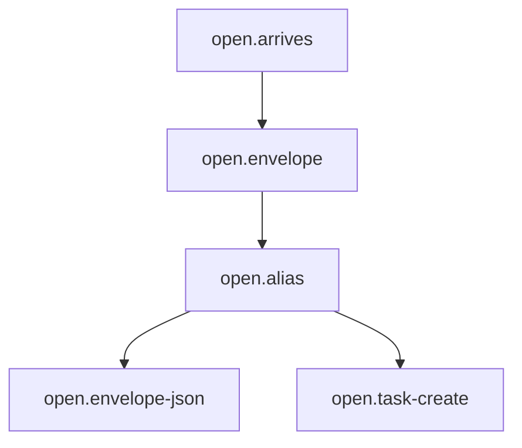

# 01 open: Open the Envelope

<!-- Hand-written text goes outside the generated blocks. `bun run render` (tools/workflow) rewrites only the lines between a block's start and end markers, from catalog.yaml and the stage.yaml files; edit the YAML, not a block. -->

<!-- generated:start summary -->

- **Stage:** 01 `open`, Open the Envelope. Facts: [`stage.yaml`](stage.yaml), 5 steps, 0 gates, 0 loops.
- **Purpose:** A new client gets one Envelope under private/, a neutral Alias, the envelope.json every Meta File copies, and one task record named by the Alias, before any question is asked.
- **Entry:** A client has written to the owner, and the owner tells the lead, naming the person, the Rank and the Domain.
- **Exit:** private/<envelope>/ holds its Drawers, a README.md that starts with the Alias and the intake date, and envelope.json; the client's Backlog.md task exists, titled by the Alias.
- **Reads from:** none. **Hands to:** [intake](../02-intake/README.md), [research](../03-research/README.md), [text-draft](../04-text-draft/README.md), [design](../05-design/README.md), [deliver](../06-deliver/README.md), [after](../07-after/README.md).

<!-- generated:end summary -->

<!-- generated:start diagram -->

<!-- generated:end diagram -->

<!-- generated:start steps -->

| ID | Name | Actor | Action | Inputs | Outputs | Gate | When |
|---|---|---|---|---|---|---|---|
| `open.arrives` | The owner names a new client | `actor.owner` | `manual.tell-new-client` | `art.client-first-message` | `art.owner-request` |  |  |
| `open.envelope` | Open the Envelope and its Drawers | `actor.lead` | `lead.open-envelope` | `art.owner-request` | `art.envelope-drawers` |  |  |
| `open.alias` | Give the client an Alias | `actor.lead` | `lead.write-alias` | `art.envelope-drawers` | `art.envelope-readme` |  |  |
| `open.envelope-json` | Write envelope.json | `actor.lead` | `lead.write-envelope-json` | `art.envelope-readme`, `art.owner-request`, `art.glossary` | `art.envelope-json` |  |  |
| `open.task-create` | Create the client's task, by Alias only | `actor.lead` | `lead.create-client-task` | `art.envelope-readme` | `art.client-task` |  |  |

<!-- generated:end steps -->

<!-- generated:start gates -->

No gates in this stage.

<!-- generated:end gates -->

<!-- generated:start loops -->

No loops in this stage.

<!-- generated:end loops -->

<!-- generated:start artifacts -->

| ID | Name | Path | Visibility | Made by |
|---|---|---|---|---|
| `art.client-first-message` | The client's first message |  | third-party | given |
| `art.client-task` | The client's Backlog.md task | `backlog/tasks/` | public | `open.task-create`, `after.close` |
| `art.envelope-drawers` | The Envelope folder and its first Drawers | `private/<envelope>/` | private | `open.envelope` |
| `art.envelope-json` | envelope.json | `private/<envelope>/envelope.json` | private | `open.envelope-json` |
| `art.envelope-readme` | The Envelope's README.md (Alias and intake date) | `private/<envelope>/README.md` | private | `open.alias` |
| `art.glossary` | The glossary's Domain ids | `docs/glossary.md` | public | given |
| `art.owner-request` | The owner's "new client" in the session |  | ephemeral | `open.arrives` |

<!-- generated:end artifacts -->

<!-- generated:start actions -->

| ID | Kind | Name | Runs |
|---|---|---|---|
| `lead.create-client-task` | lead | Create the client's task | Creates one Backlog.md task for the client, named by the Alias only, since backlog/ is public. |
| `lead.open-envelope` | lead | Open the Envelope | Creates private/<name>-<rank>/ in the one Envelope tree with README.md, intake/ (messages.md, documents/), research/ (reviews/) and draft/; never under examples/. |
| `lead.write-alias` | lead | Write the Alias and intake date | Gives the client an Alias client-<yyyy>-<mm>-<nn> and writes it at the top of the Envelope's README.md with the date intake started; outside private/ the client is only ever the Alias. |
| `lead.write-envelope-json` | lead | Write envelope.json | Writes alias, domain (an id from the glossary's Domain row), candidate (the display name) and rank; every Meta File in the Envelope copies it and scripts/cv.py render refuses to run without it. |
| `manual.tell-new-client` | manual | Tell the lead about a new client | The owner tells the lead a new client has arrived, naming the person, the Rank and the Domain. |

<!-- generated:end actions -->
