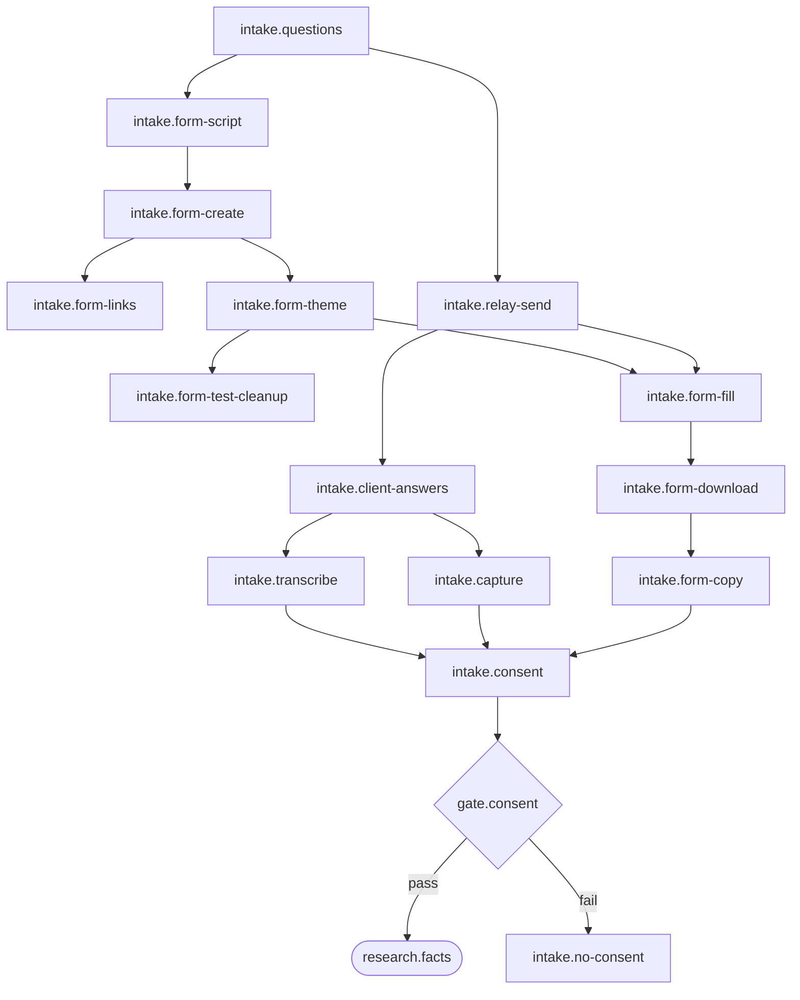

# 02 intake: Intake by Relay

<!-- Hand-written text goes outside the generated blocks. `bun run render` (tools/workflow) rewrites only the lines between a block's start and end markers, from catalog.yaml and the stage.yaml files; edit the YAML, not a block. -->

<!-- generated:start summary -->

- **Stage:** 02 `intake`, Intake by Relay. Facts: [`stage.yaml`](stage.yaml), 15 steps, 1 gate, 0 loops.
- **Purpose:** The client answers one question list, consent first, through the owner (and optionally an Intake Form beside the chat message); nothing after this stage starts before the client's "I agree" is in intake/messages.md.
- **Entry:** The Envelope and envelope.json exist (stage open).
- **Exit:** intake/messages.md holds the client's answers with his "I agree", and his photos and files are in intake/documents/; or the owner has decided to ask for consent again or to stop.
- **Reads from:** [open](../01-open/README.md). **Hands to:** [research](../03-research/README.md), [design](../05-design/README.md), [after](../07-after/README.md).

<!-- generated:end summary -->

## Judgement

- **One message, adapted, consent first.** `intake.questions` starts from
  the master list (`art.master-question-list`) and adapts it to the
  `Client`'s `Domain` and target: examples he recognises, questions that
  apply to his work. It stays one message, in simple, friendly Greek. The
  owner pastes it into the chat app the `Client` already uses (Viber,
  WhatsApp, email), and the `Client` answers in any order, in text or
  voice messages, over a few days.
- **Consent is a hard stop** (`gate.consent`). Until the "I agree" is in
  `intake/messages.md`, the lead reads no document, writes no fact and
  does no research, even when the `Client` sends his papers first.
- **What the consent covers**, as question 1 of the list words it: AI
  tools and web research, his details kept in private files and never
  published, and deletion 12 months after delivery unless he asks to keep
  them (`after.keep-request`).
- **The lead reads text only.** Voice messages go through
  `intake.transcribe` (the phone's transcript or the owner's gist) before
  anything is read. The owner brings the answers in (`intake.capture`):
  the chat text into `intake/messages.md` (a WhatsApp "Export chat" file
  works as is), photos and files into `intake/documents/`. A `Client`'s
  LinkedIn page is never opened; the PDF export he sends is enough.
- **When intake is done.** Consent is in and the answers have stopped
  coming; with a form, the `Client` says he is done
  (`intake.form-download`). Intake is not the place to chase gaps: what is
  missing goes into the gap list in `research.facts` and is asked once, in
  the follow-up.

## Branches

- **The `Intake Form`** (`intake.form-script` to `intake.form-copy`) runs
  only when the owner wants one, and always beside the chat message, never
  instead of it: the message carries the link and the offer to answer by
  chat. A form is designed, not a list of text boxes: pages by topic, the
  quickest question type for each answer, the house theme
  (`intake.form-theme`).
- **Voice messages** add `intake.transcribe` before the consent check.
- **No consent** (`gate.consent` fails): `intake.no-consent`. The owner
  decides to ask again or to stop. It is one owner step, not a loop
  ([`GAPS.md`](../GAPS.md), "Inferences"); the recommendation "ask once
  more, then stop" waits in [P-0018](../../proposals/workflow-gaps.md)
  item 2. A stopped `Client` stays in `private/` until `after.stall-check`
  names him and the owner decides to delete.

## Common mistakes

- Reading the attachments or starting the facts before the "I agree".
- Sending the form instead of the chat message, or a form with upload
  questions (they force a Google sign-in; photos come by chat).
- Leaving the owner's test answer in the form or its Sheet: it has to go
  in both places before the `Client` answers (`intake.form-test-cleanup`).
- Misreading a CSV date: the Sheet writes dates in its own locale, so a
  date such as 3/4 is read with care (`intake.form-copy`).
- Writing a second list of questions for what the first answers left out;
  that is the follow-up's job (`research.follow-up-write`).

## Reference detail

- `docs/guides/client-workflow.md` section 2: the master question list;
  section 3: the `Intake Form`, from script to theme to CSV.
- The `new-client` skill: the checklist, by step ID; the header of
  `scripts/intake-form.gs`.

## Diagram

<!-- generated:start diagram -->

<!-- generated:end diagram -->

## Steps

<!-- generated:start steps -->

| ID | Name | Actor | Action | Inputs | Outputs | Gate | When |
|---|---|---|---|---|---|---|---|
| `intake.questions` | Write the question list in Greek, consent first | `actor.lead` | `lead.write-question-list` | `art.envelope-json`, `art.master-question-list` | `art.question-list` |  |  |
| `intake.form-script` | Write the Intake Form script | `actor.lead` | `lead.write-form-script` | `art.question-list`, `art.intake-form-lib` | `art.form-gs` |  | The owner wants an Intake Form. |
| `intake.form-create` | Run createIntakeForm in Google | `actor.owner` | `manual.run-form-script` | `art.form-gs` | `art.google-form`, `art.google-sheet`, `art.script-project`, `art.form-links` |  | The owner wants an Intake Form. |
| `intake.form-links` | List the Google links in README.md | `actor.lead` | `lead.list-google-links` | `art.form-links` | `art.readme-google-links` |  | The owner wants an Intake Form. |
| `intake.form-theme` | Give the form the house theme | `actor.owner` | `manual.apply-form-theme` | `art.google-form`, `art.intake-header-png` | `art.google-form-themed` |  | The owner wants an Intake Form. |
| `intake.form-test-cleanup` | Delete the owner's test answer | `actor.owner` | `manual.delete-test-answer` | `art.google-form-themed`, `art.google-sheet` |  |  | The owner made a test answer. |
| `intake.relay-send` | Paste the questions to the client | `actor.owner` | `manual.paste-message` | `art.question-list` | `art.intake-message` |  |  |
| `intake.client-answers` | The client answers by chat | `actor.client` | `manual.client-answer` | `art.intake-message` | `art.client-answers` |  |  |
| `intake.form-fill` | The client answers in the Intake Form | `actor.client` | `manual.client-answer` | `art.intake-message`, `art.google-form-themed` | `art.form-responses` |  | An Intake Form was sent. |
| `intake.transcribe` | Transcribe voice messages | `actor.owner` | `manual.transcribe-voice` | `art.client-answers` | `art.messages-md` |  | The client sent voice messages. |
| `intake.capture` | Bring the chat answers into the Envelope | `actor.owner` | `manual.copy-chat-to-envelope` | `art.client-answers` | `art.messages-md`, `art.documents` |  |  |
| `intake.form-download` | Download the form answers as CSV | `actor.owner` | `manual.download-answers-csv` | `art.form-responses` | `art.answers-csv` |  | An Intake Form was sent and the client says he is done. |
| `intake.form-copy` | Copy the form answers into messages.md | `actor.lead` | `lead.copy-form-answers` | `art.answers-csv` | `art.messages-md` |  | An Intake Form was sent. |
| `intake.consent` | Check consent (hard stop) | `actor.lead` | `lead.check-consent` | `art.messages-md` |  | `gate.consent` |  |
| `intake.no-consent` | No consent; the owner decides | `actor.owner` | `manual.decide-on-no-consent` | `art.messages-md` |  |  |  |

<!-- generated:end steps -->

## Gates

<!-- generated:start gates -->

| ID | Name | Checked by | Check | Pass | Fail |
|---|---|---|---|---|---|
| `gate.consent` | Consent | `intake.consent` | The client's "I agree" is in intake/messages.md. | `research.facts` (stage `research`) | `intake.no-consent` |

<!-- generated:end gates -->

## Loops

<!-- generated:start loops -->

No loops in this stage.

<!-- generated:end loops -->

## Artifacts

<!-- generated:start artifacts -->

| ID | Name | Path | Visibility | Made by |
|---|---|---|---|---|
| `art.answers-csv` | The downloaded form answers | `private/<envelope>/intake/answers-NN.csv` | private | `intake.form-download` |
| `art.client-answers` | The client's chat answers |  | third-party | `intake.client-answers` |
| `art.documents` | The client's documents | `private/<envelope>/intake/documents/` | private | `intake.capture` |
| `art.envelope-json` | envelope.json | `private/<envelope>/envelope.json` | private | `open.envelope-json` |
| `art.form-gs` | The Intake Form script copy | `private/<envelope>/intake/form-NN.gs` | private | `intake.form-script` |
| `art.form-links` | The four Google links |  | third-party | `intake.form-create` |
| `art.form-responses` | The client's form answers |  | third-party | `intake.form-fill` |
| `art.google-form` | The Intake Form |  | third-party | `intake.form-create` |
| `art.google-form-themed` | The Intake Form with the house theme |  | third-party | `intake.form-theme` |
| `art.google-sheet` | The answers Sheet |  | third-party | `intake.form-create` |
| `art.intake-form-lib` | The Intake Form script | `scripts/intake-form.gs` | public | given |
| `art.intake-header-png` | The Intake Form header image | `studio/brand/forms/intake-header.png` | public | given |
| `art.intake-message` | The questions in the client's chat |  | third-party | `intake.relay-send` |
| `art.master-question-list` | The master question list | `docs/guides/client-workflow.md` | public | given |
| `art.messages-md` | messages.md (intake answers) | `private/<envelope>/intake/messages.md` | private | `intake.transcribe`, `intake.capture`, `intake.form-copy` |
| `art.question-list` | The question list, ready to paste |  | ephemeral | `intake.questions` |
| `art.readme-google-links` | README.md, section "Google" | `private/<envelope>/README.md` | private | `intake.form-links` |
| `art.script-project` | The Apps Script project |  | third-party | `intake.form-create` |

<!-- generated:end artifacts -->

## Actions

<!-- generated:start actions -->

| ID | Kind | Name | Runs |
|---|---|---|---|
| `lead.check-consent` | lead | Check consent | Looks for the client's "I agree" in intake/messages.md; until it is there, reads no documents, writes no facts and does no research. |
| `lead.copy-form-answers` | lead | Copy the form answers | Copies the answers from answers-NN.csv into intake/messages.md, reading ambiguous dates such as 3/4 with care. |
| `lead.list-google-links` | lead | List the Google links | Lists the links the owner brings back under "Google" in the Envelope's README.md. |
| `lead.write-form-script` | lead | Write the Intake Form script | Writes intake/form-NN.gs, a copy of scripts/intake-form.gs with only its FORM block changed: title, intro, consent, questions; pages by topic and the quickest question type, in the polite plural. |
| `lead.write-question-list` | lead | Write the question list | Writes the guide's 13 questions, consent first, as one message in simple, friendly Greek adapted to the client's Domain and target, ready for the owner to paste. |
| `manual.apply-form-theme` | manual | Apply the house theme | Before sending the link, the owner sets the form's theme: header studio/brand/forms/intake-header.png, colour #B0602B, the warm-paper background swatch, Bona Nova for the header and Source Sans 3 for questions and text. |
| `manual.client-answer` | manual | The client answers | The client answers in any order, in text or voice messages, over a few days, or in the Intake Form. |
| `manual.copy-chat-to-envelope` | manual | Bring the answers into the Envelope | The owner copies the chat text into intake/messages.md (a WhatsApp "Export chat" file works as is) and saves photos and files into intake/documents/. |
| `manual.decide-on-no-consent` | manual | Decide on a client without consent | The owner decides whether to ask the client again or to stop; a stopped client is named by after.stall-check after three months and deleted on the owner's word (after.erase-commands, after.erase-envelope). |
| `manual.delete-test-answer` | manual | Delete the test answer | The owner deletes his test answer in the form's Responses tab and its row in the Sheet, before the client answers. |
| `manual.download-answers-csv` | manual | Download the answers as CSV | In the answers Sheet, with "Form Responses 1" open: File, Download, Comma-separated values, saved as intake/answers-NN.csv. |
| `manual.paste-message` | manual | Paste the message to the client | The owner pastes the lead's message into the chat app the client already uses (Viber, WhatsApp, email). |
| `manual.run-form-script` | manual | Run the Intake Form script | The owner pastes form-NN.gs into a new script.google.com project named after the Alias, runs createIntakeForm once (Advanced, then Go to the project, on the first run), and passes the three logged links and the project's link back. A mistake in FORM fails before anything is created. |
| `manual.transcribe-voice` | manual | Transcribe voice messages | The phone transcribes the voice messages, or the owner types the gist; the lead reads text only. |

<!-- generated:end actions -->
