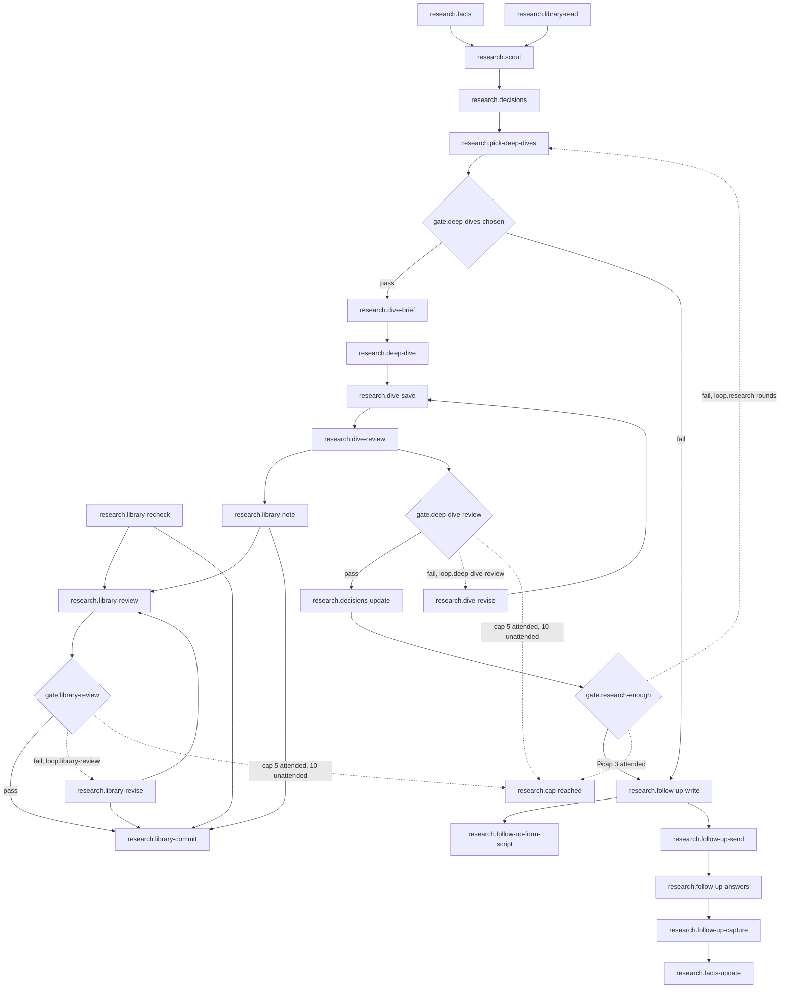

# 03 research: Facts, Scout, CV Decisions, Deep Dives and one follow-up

<!-- Hand-written text goes outside the generated blocks. `bun run render` (tools/workflow) rewrites only the lines between a block's start and end markers, from catalog.yaml and the stage.yaml files; edit the YAML, not a block. -->

<!-- generated:start summary -->

- **Stage:** 03 `research`, Facts, Scout, CV Decisions, Deep Dives and one follow-up. Facts: [`stage.yaml`](stage.yaml), 23 steps, 4 gates, 3 loops.
- **Purpose:** Turn the client's answers into sourced facts, research what this client's target expects, decide what the CV must say, and ask the client once more, in one batch, for what is still missing.
- **Entry:** The client's "I agree" is in intake/messages.md (gate.consent passed).
- **Exit:** intake/facts.md is final after the one follow-up, research/decisions.md answers every decision with a source or a stated judgement, and every Deep Dive has a research-reviewer PASS or reached the owner marked unresolved.
- **Reads from:** [open](../01-open/README.md), [intake](../02-intake/README.md). **Hands to:** [text-draft](../04-text-draft/README.md), [design](../05-design/README.md).

<!-- generated:end summary -->

## Judgement

- **Facts are sourced or absent.** `research.facts` writes identity,
  target, each job with its scope and results, certificates, education,
  languages and what may be shown, each fact with the message or document
  it came from. Nothing is invented, and a
  calendar period is never turned into service time (constitution section
  6). What is missing goes in the gap list and waits: asking now would
  spend the one follow-up early.
- **Library first, then the web.** `research.library-read` comes before
  `research.scout`; a note past its "Recheck after" date is rechecked
  (`research.library-recheck`) before the `Scout` leans on it. The `Scout`
  is wide and shallow: the country's CV norms, what the target employers
  and the `Rank` expect, how CVs are sent (agency portal, applicant
  tracking system, email); `scout.md` numbers its findings, each with a
  source and its date, then lists the open questions. No search
  ever carries the `Client`'s name, contact details or a combination that
  identifies him (his employer with his `Rank` and dates, a vessel with
  its crew position): search for "chief officers applying to Norwegian
  shipowners", never the person.
- **Every decision gets an answer, a judgement or "open".**
  `research.decisions` writes one line per choice the CV must make, and
  shows the owner the open ones with a recommendation each. The owner, not
  the lead, picks which get a `Deep Dive` (`research.pick-deep-dives`):
  0-3 per `Client`, up to 6 for an executive aiming at named companies.
- **When to stop** (`gate.research-enough`): every `CV Decisions` line has
  a sourced answer or a stated judgement. A new source that changes no
  decision is the signal to stop; running out of sources is not the test.
- **What a `Deep Dive` may hold.** The author gets the `Alias` only, never
  the `Envelope` path (`research.dive-brief`), and returns text, not files.
  `research.dive-save` saves it as `research/deep-dive-<topic>.md` and
  checks it for client details before any reviewer
  sees it; the reviewer gets the text inline with its SHA-256 and the
  question it answers, because it never reads `private/`, and its reports
  stay in the `Envelope` (`research/reviews/<topic>-NN.md`). The same
  author revises (`research.dive-revise`); each review round is a fresh
  reviewer.
- **What goes public.** A finding about a country, a `Domain` or a `Rank`,
  with nothing about the `Client`, also becomes a `Research Library` note
  (`research.library-note`), written free of client detail first and
  reviewed on its own text. A finding about one employer stays in the
  `Envelope` until a second `Client` targets the same employer.
- **The one follow-up** (`research.follow-up-write`) is the gap list plus
  the questions research raised, in one batch, in simple Greek. As a chat
  message: aim for 5 questions, never more than 10. As an `Intake Form`
  the cap is effort, not a count (`docs/guides/client-workflow.md` section
  3), and the chat message carries the link and offers to answer there
  instead. Whatever is still missing after
  it is left out of the CV or marked not supplied (`research.facts-update`);
  the `Client` is asked again only on the owner's word.

## Branches

- **No `Deep Dive` chosen** (`gate.deep-dives-chosen` fails): straight to
  the follow-up. No `Deep Dive` is a normal answer.
- **A `Deep Dive` with findings** (`gate.deep-dive-review` fails): the same
  author revises and a fresh reviewer checks again, up to the cap of
  `loop.deep-dive-review`; at the cap it reaches the owner marked
  unresolved (`research.cap-reached`).
- **Research not yet enough** (`gate.research-enough` fails): back to the
  owner for more `Deep Dive`s (`loop.research-rounds`, 3 rounds for every
  `Client`; at the cap the owner decides whether an executive gets more;
  [P-0018](../../proposals/workflow-gaps.md) item 1b).
- **A library note** runs its own review loop (`gate.library-review`,
  `loop.library-review`) and is committed to the public
  repository on PASS (`research.library-commit`).
- **The follow-up as an `Intake Form`**: `research.follow-up-form-script`
  writes the script; the owner then makes, themes and sends it as in
  `intake`.
- **The `Client` never answers the follow-up.** No step models it:
  `research.facts-update` waits for the answers. Three months after the
  intake date, `after.stall-check` names the `Client` to the owner. Each
  further follow-up goes out only on the owner's word, with no cap on how
  many (`lead.update-facts`; [P-0018](../../proposals/workflow-gaps.md)
  item 3).

## Common mistakes

- Sending the gap list straight after intake, then asking again after
  research: the `Client` is asked twice.
- Putting the `Envelope` path, the name or an identifying detail in an
  agent brief, a web search or a library note.
- Researching on after every decision is settled.
- Sending a further follow-up without the owner's word.

## Reference detail

- `docs/guides/client-workflow.md` section 4: what `CV Decisions` lines
  look like; section 3: the follow-up as an `Intake Form`.
- The `new-client` skill: the checklist, by step ID, and the brief for a
  `Scout` or `Deep Dive` agent; `docs/research/README.md` for library
  notes.

## Diagram

<!-- generated:start diagram -->

<!-- generated:end diagram -->

## Steps

<!-- generated:start steps -->

| ID | Name | Actor | Action | Inputs | Outputs | Gate | When |
|---|---|---|---|---|---|---|---|
| `research.facts` | Write the facts and the gap list | `actor.lead` | `lead.write-facts` | `art.messages-md`, `art.documents` | `art.facts-md` |  |  |
| `research.library-read` | Read the Research Library first | `actor.lead` | `lead.read-library` | `art.research-library` | `art.library-findings` |  |  |
| `research.library-recheck` | Recheck a library note past its date | `actor.lead` | `lead.recheck-library-note` | `art.research-library` | `art.research-note` |  | A note the Scout needs is past its "Recheck after" date. |
| `research.scout` | Scout the client's target | `actor.lead` | `lead.scout` | `art.facts-md`, `art.library-findings`, `art.envelope-json` | `art.scout-md` |  |  |
| `research.decisions` | Write the CV Decisions | `actor.lead` | `lead.write-decisions` | `art.facts-md`, `art.scout-md` | `art.decisions-md`, `art.open-decisions` |  |  |
| `research.pick-deep-dives` | The owner picks the Deep Dives | `actor.owner` | `manual.pick-deep-dives` | `art.open-decisions` | `art.deep-dive-choice` | `gate.deep-dives-chosen` |  |
| `research.dive-brief` | Brief the Deep Dive author | `actor.lead` | `lead.brief-deep-dive` | `art.deep-dive-choice` | `art.dive-brief` |  | Once per Deep Dive question the owner chose. |
| `research.deep-dive` | Write the Deep Dive | `actor.general-purpose` | `agent.general-purpose` | `art.dive-brief` | `art.deep-dive-text` |  | Once per Deep Dive question the owner chose. |
| `research.dive-save` | Save the Deep Dive and check it for client details | `actor.lead` | `lead.save-deep-dive` | `art.deep-dive-text` | `art.deep-dive-md` |  | Once per Deep Dive question the owner chose. |
| `research.dive-review` | A fresh research-reviewer checks the Deep Dive | `actor.research-reviewer` | `agent.research-reviewer` | `art.deep-dive-md` | `art.deep-dive-review` | `gate.deep-dive-review` | Once per Deep Dive question the owner chose. |
| `research.dive-revise` | The same author revises | `actor.general-purpose` | `agent.general-purpose-revise` | `art.deep-dive-review` | `art.deep-dive-text` |  | Once per Deep Dive question the owner chose, after a FINDINGS verdict. |
| `research.library-note` | Write or update a Research Library note | `actor.lead` | `lead.write-library-note` | `art.deep-dive-md`, `art.deep-dive-review` | `art.research-note` |  | A Deep Dive found something about a country, a Domain or a Rank, with nothing about the client. |
| `research.library-review` | A fresh research-reviewer checks the note | `actor.research-reviewer` | `agent.research-reviewer` | `art.research-note` | `art.library-review-report` | `gate.library-review` | A library note was written, updated or rechecked. |
| `research.library-revise` | Revise the library note | `actor.lead` | `lead.revise-library-note` | `art.library-review-report` | `art.research-note` |  | The note's review returned FINDINGS. |
| `research.library-commit` | Commit the reviewed note | `actor.lead` | `lead.commit-library-note` | `art.research-note`, `art.library-review-report` |  |  | The note's review returned PASS. |
| `research.decisions-update` | Update the CV Decisions from the Deep Dives | `actor.lead` | `lead.update-decisions` | `art.deep-dive-md`, `art.deep-dive-review` | `art.decisions-md`, `art.open-decisions` | `gate.research-enough` |  |
| `research.follow-up-write` | Write the one follow-up batch | `actor.lead` | `lead.write-follow-up` | `art.facts-md`, `art.scout-md`, `art.decisions-md` | `art.follow-up-questions` |  |  |
| `research.follow-up-form-script` | Write the follow-up Intake Form script | `actor.lead` | `lead.write-form-script` | `art.follow-up-questions`, `art.intake-form-lib` | `art.follow-up-form-gs` |  | The follow-up goes as an Intake Form. |
| `research.follow-up-send` | Send the follow-up | `actor.owner` | `manual.paste-message` | `art.follow-up-questions` | `art.follow-up-message` |  |  |
| `research.follow-up-answers` | The client answers the follow-up | `actor.client` | `manual.client-answer` | `art.follow-up-message` | `art.follow-up-answers` |  |  |
| `research.follow-up-capture` | Bring the follow-up answers into the Envelope | `actor.owner` | `manual.copy-chat-to-envelope` | `art.follow-up-answers` | `art.messages-follow-up` |  |  |
| `research.facts-update` | Make facts.md final | `actor.lead` | `lead.update-facts` | `art.messages-follow-up`, `art.facts-md` | `art.facts-final` |  |  |
| `research.cap-reached` | At a loop's cap, the owner decides | `actor.owner` | `manual.decide-at-cap` |  |  |  |  |

<!-- generated:end steps -->

## Gates

<!-- generated:start gates -->

| ID | Name | Checked by | Check | Pass | Fail |
|---|---|---|---|---|---|
| `gate.deep-dives-chosen` | Any Deep Dive chosen | `research.pick-deep-dives` | The owner chose at least one open decision for a Deep Dive (0-3 per client, up to 6 for an executive aiming at named companies). | `research.dive-brief` | `research.follow-up-write` |
| `gate.deep-dive-review` | Deep Dive review | `research.dive-review` | A fresh research-reviewer returns PASS on the Deep Dive's text and SHA-256. | `research.decisions-update` | `research.dive-revise` |
| `gate.library-review` | Library note review | `research.library-review` | A fresh research-reviewer returns PASS on the note's own text and hash. | `research.library-commit` | `research.library-revise` |
| `gate.research-enough` | Research is enough | `research.decisions-update` | Every decision has a sourced answer or a stated judgement (a new source that changes no decision is the signal to stop). | `research.follow-up-write` | `research.pick-deep-dives` |

<!-- generated:end gates -->

## Loops

<!-- generated:start loops -->

| ID | Name | Gate | Cap | At the cap |
|---|---|---|---|---|
| `loop.deep-dive-review` | Deep Dive review rounds | `gate.deep-dive-review` | 5 attended, 10 unattended | `research.cap-reached` |
| `loop.library-review` | Library note review rounds | `gate.library-review` | 5 attended, 10 unattended | `research.cap-reached` |
| `loop.research-rounds` | More Deep Dives until research is enough | `gate.research-enough` | 3 attended | `research.cap-reached` |

<!-- generated:end loops -->

## Artifacts

<!-- generated:start artifacts -->

| ID | Name | Path | Visibility | Made by |
|---|---|---|---|---|
| `art.decisions-md` | CV Decisions (decisions.md) | `private/<envelope>/research/decisions.md` | private | `research.decisions`, `research.decisions-update` |
| `art.deep-dive-choice` | The owner's Deep Dive choice |  | ephemeral | `research.pick-deep-dives` |
| `art.deep-dive-md` | The saved Deep Dive | `private/<envelope>/research/deep-dive-<topic>.md` | private | `research.dive-save` |
| `art.deep-dive-review` | A Deep Dive's review report | `private/<envelope>/research/reviews/<topic>-NN.md` | private | `research.dive-review` |
| `art.deep-dive-text` | The Deep Dive's returned text |  | ephemeral | `research.deep-dive`, `research.dive-revise` |
| `art.dive-brief` | The Deep Dive brief |  | ephemeral | `research.dive-brief` |
| `art.documents` | The client's documents | `private/<envelope>/intake/documents/` | private | `intake.capture` |
| `art.envelope-json` | envelope.json | `private/<envelope>/envelope.json` | private | `open.envelope-json` |
| `art.facts-final` | facts.md, final | `private/<envelope>/intake/facts.md` | private | `research.facts-update`, `text-draft.corrections` |
| `art.facts-md` | facts.md with the gap list | `private/<envelope>/intake/facts.md` | private | `research.facts` |
| `art.follow-up-answers` | The client's follow-up answers |  | third-party | `research.follow-up-answers` |
| `art.follow-up-form-gs` | The follow-up Intake Form script copy | `private/<envelope>/intake/form-NN.gs` | private | `research.follow-up-form-script` |
| `art.follow-up-message` | The follow-up in the client's chat |  | third-party | `research.follow-up-send` |
| `art.follow-up-questions` | The follow-up batch, ready to send |  | ephemeral | `research.follow-up-write` |
| `art.intake-form-lib` | The Intake Form script | `scripts/intake-form.gs` | public | given |
| `art.library-findings` | What the library already answers |  | ephemeral | `research.library-read` |
| `art.library-review-report` | A library note's review report | `archive/work-records/research-<topic>/reviews/` | public | `research.library-review` |
| `art.messages-follow-up` | messages.md (follow-up answers) | `private/<envelope>/intake/messages.md` | private | `research.follow-up-capture` |
| `art.messages-md` | messages.md (intake answers) | `private/<envelope>/intake/messages.md` | private | `intake.transcribe`, `intake.capture`, `intake.form-copy` |
| `art.open-decisions` | The open decisions, with a recommendation each |  | ephemeral | `research.decisions`, `research.decisions-update` |
| `art.research-library` | The Research Library | `docs/research/` | public | given |
| `art.research-note` | A Research Library note | `docs/research/<scope>-<topic>.md` | public | `research.library-recheck`, `research.library-note`, `research.library-revise` |
| `art.scout-md` | The Scout's findings | `private/<envelope>/research/scout.md` | private | `research.scout` |

<!-- generated:end artifacts -->

## Actions

<!-- generated:start actions -->

| ID | Kind | Name | Runs |
|---|---|---|---|
| `agent.general-purpose` | agent | A background general-purpose agent | agent `general-purpose` |
| `agent.general-purpose-revise` | agent | The same general-purpose author, by SendMessage | agent `general-purpose` |
| `agent.research-reviewer` | agent | A fresh research-reviewer round | agent `research-reviewer` |
| `lead.brief-deep-dive` | lead | Brief a Deep Dive author | Fills the skill's brief with one question, why it matters, what is known, the rules and the Alias only, never the Envelope path. |
| `lead.commit-library-note` | lead | Commit the library note | Commits the note and its reports like any documentation. |
| `lead.read-library` | lead | Read the Research Library | Reads docs/research/ before searching the web. |
| `lead.recheck-library-note` | lead | Recheck a library note | Checks the note's load-bearing claims again, moves both dates and records what changed. |
| `lead.revise-library-note` | lead | Revise the library note | Fixes the note on the reviewer's findings before the next fresh round. |
| `lead.save-deep-dive` | lead | Save and clean the Deep Dive | Saves the returned text as research/deep-dive-<topic>.md and checks it for client details before any reviewer sees it. |
| `lead.scout` | lead | Scout | Searches the web for what the library lacks (or briefs one general-purpose agent): the country's CV norms, what the employers and the Rank expect, how CVs are sent; never with the client's name or an identifying combination; writes research/scout.md. |
| `lead.update-decisions` | lead | Update the CV Decisions | Answers the open lines of research/decisions.md from the reviewed Deep Dives, each with its source. |
| `lead.update-facts` | lead | Make the facts final | Updates facts.md from the answers; anything still missing is left out or marked not supplied. The client is asked again only on the owner's word: each further follow-up needs it, and their number has no cap. |
| `lead.write-decisions` | lead | Write the CV Decisions | Writes research/decisions.md, one line per decision, and shows the owner the open ones with a recommendation for each. |
| `lead.write-facts` | lead | Write the facts | Writes intake/facts.md: every fact names the message or document it came from, nothing is invented, no calendar period is turned into service time; what is missing goes in a gap list at the end, held for the follow-up. |
| `lead.write-follow-up` | lead | Write the follow-up | Writes the gap list plus any question the research raised (the Scout's open questions, and what the Deep Dives left in decisions.md) as one batch in simple Greek, within the cap for a chat message or an Intake Form. |
| `lead.write-form-script` | lead | Write the Intake Form script | Writes intake/form-NN.gs, a copy of scripts/intake-form.gs with only its FORM block changed: title, intro, consent, questions; pages by topic and the quickest question type, in the polite plural. |
| `lead.write-library-note` | lead | Write the library note | Writes or updates the note in docs/research/ in the same session, free of client detail first; a finding about one employer stays in the Envelope until a second client targets it. |
| `manual.client-answer` | manual | The client answers | The client answers in any order, in text or voice messages, over a few days, or in the Intake Form. |
| `manual.copy-chat-to-envelope` | manual | Bring the answers into the Envelope | The owner copies the chat text into intake/messages.md (a WhatsApp "Export chat" file works as is) and saves photos and files into intake/documents/. |
| `manual.decide-at-cap` | manual | The owner decides at the cap | At a loop's cap (a review loop, the client's draft corrections, the owner's own changes or a render that keeps failing) the lead stops and brings the owner the open item with its last reason; another round needs his decision. |
| `manual.paste-message` | manual | Paste the message to the client | The owner pastes the lead's message into the chat app the client already uses (Viber, WhatsApp, email). |
| `manual.pick-deep-dives` | manual | Pick the Deep Dives | The owner picks which open decisions get a Deep Dive. |

<!-- generated:end actions -->
