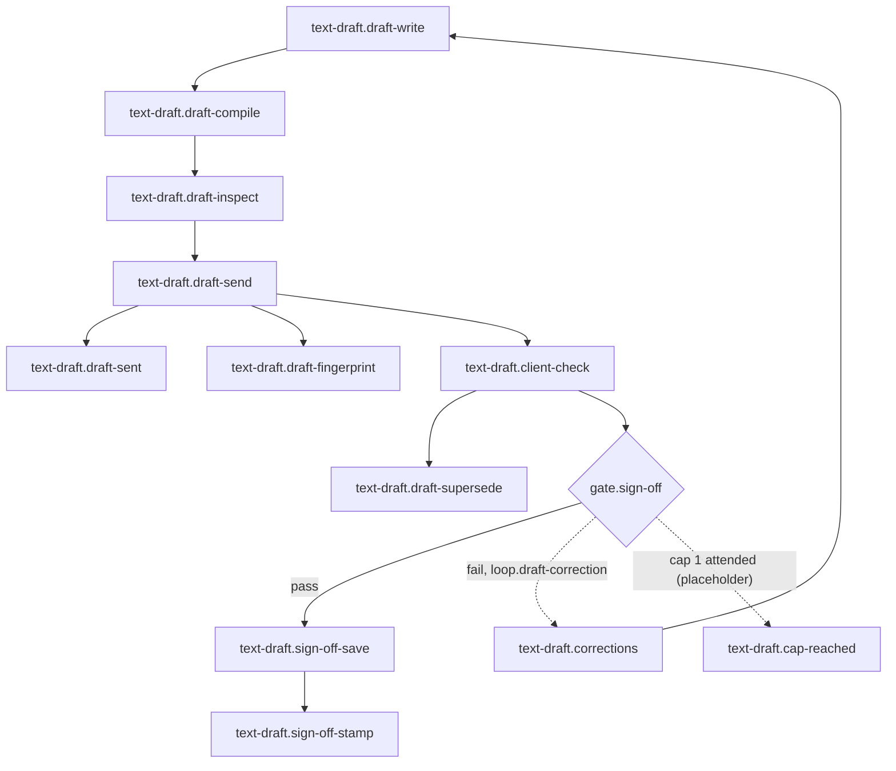

# 04 text-draft: Text Draft and Sign-off

<!-- Hand-written text goes outside the generated blocks. `bun run render` (tools/workflow) rewrites only the lines between a block's start and end markers, from catalog.yaml and the stage.yaml files; edit the YAML, not a block. -->

<!-- generated:start summary -->

- **Stage:** 04 `text-draft`, Text Draft and Sign-off. Facts: [`stage.yaml`](stage.yaml), 12 steps, 1 gate, 1 loop.
- **Purpose:** The client checks every fact of the CV in the Text Draft before any design work starts.
- **Entry:** intake/facts.md is final after the one follow-up (stage research).
- **Exit:** The client's OK is saved as draft/sign-off-NN.png beside the draft it answers, and that draft's Meta File says signed-off.
- **Reads from:** [open](../01-open/README.md), [research](../03-research/README.md). **Hands to:** [design](../05-design/README.md).

<!-- generated:end summary -->

<!-- generated:start diagram -->

<!-- generated:end diagram -->

<!-- generated:start steps -->

| ID | Name | Actor | Action | Inputs | Outputs | Gate | When |
|---|---|---|---|---|---|---|---|
| `text-draft.draft-write` | Write the Text Draft | `actor.lead` | `lead.write-text-draft` | `art.facts-final`, `art.decisions-md`, `art.text-draft-lib` | `art.draft-typ` |  |  |
| `text-draft.draft-compile` | Compile the draft and stamp it ready | `actor.lead` | `cmd.compile-and-stamp-draft-ready` | `art.draft-typ`, `art.text-draft-lib`, `art.framework-fonts`, `art.envelope-json`, `art.output-schema` | `art.draft-pdf`, `art.draft-meta` |  |  |
| `text-draft.draft-inspect` | Look at every page; give the owner the path | `actor.lead` | `lead.inspect-draft` | `art.draft-pdf` | `art.draft-ready-note` |  |  |
| `text-draft.draft-send` | The owner sends the draft | `actor.owner` | `manual.send-draft` | `art.draft-ready-note`, `art.draft-pdf` | `art.draft-message` |  |  |
| `text-draft.draft-sent` | Stamp the draft sent | `actor.lead` | `cmd.stamp-draft-sent` | `art.draft-message` | `art.draft-meta` |  |  |
| `text-draft.draft-fingerprint` | Write the sent draft's SHA-256 in README.md | `actor.lead` | `lead.write-draft-fingerprint` | `art.draft-message` | `art.readme-draft-fingerprint` |  |  |
| `text-draft.client-check` | The client checks the underlined facts | `actor.client` | `manual.client-checks-draft` | `art.draft-message` | `art.client-reply` | `gate.sign-off` |  |
| `text-draft.draft-supersede` | Stamp the old draft superseded | `actor.lead` | `cmd.stamp-draft-superseded` | `art.client-reply` | `art.draft-meta` |  | The client asked for corrections. |
| `text-draft.corrections` | Take the corrections into the next number | `actor.lead` | `lead.take-corrections` | `art.client-reply` | `art.facts-final` |  | The client asked for corrections. |
| `text-draft.sign-off-save` | The owner saves the Sign-off screenshot | `actor.owner` | `manual.screenshot-sign-off` | `art.client-reply` | `art.sign-off-png` |  |  |
| `text-draft.sign-off-stamp` | Stamp the draft signed-off | `actor.lead` | `cmd.stamp-draft-signed-off` | `art.sign-off-png`, `art.draft-pdf` | `art.draft-meta` |  |  |
| `text-draft.cap-reached` | At the cap, the owner decides | `actor.owner` | `manual.decide-at-cap` |  |  |  |  |

<!-- generated:end steps -->

<!-- generated:start gates -->

| ID | Name | Checked by | Check | Pass | Fail |
|---|---|---|---|---|---|
| `gate.sign-off` | Sign-off | `text-draft.client-check` | The client replied OK to the underlined facts. | `text-draft.sign-off-save` | `text-draft.corrections` |

<!-- generated:end gates -->

<!-- generated:start loops -->

| ID | Name | Gate | Cap | At the cap |
|---|---|---|---|---|
| `loop.draft-correction` | Draft correction rounds (placeholder cap) | `gate.sign-off` | 1 attended, **placeholder** ([GAPS.md](../GAPS.md)) | `text-draft.cap-reached` |

<!-- generated:end loops -->

<!-- generated:start artifacts -->

| ID | Name | Path | Visibility | Made by |
|---|---|---|---|---|
| `art.client-reply` | The client's reply to the draft |  | third-party | `text-draft.client-check` |
| `art.decisions-md` | CV Decisions (decisions.md) | `private/<envelope>/research/decisions.md` | private | `research.decisions`, `research.decisions-update` |
| `art.draft-message` | The Text Draft in the client's chat |  | third-party | `text-draft.draft-send` |
| `art.draft-meta` | The Text Draft's Meta File | `private/<envelope>/draft/draft-NN.meta.json` | private | `text-draft.draft-compile`, `text-draft.draft-sent`, `text-draft.draft-supersede`, `text-draft.sign-off-stamp` |
| `art.draft-pdf` | Text Draft PDF | `private/<envelope>/draft/draft-NN.pdf` | private | `text-draft.draft-compile` |
| `art.draft-ready-note` | The draft's path, for the owner |  | ephemeral | `text-draft.draft-inspect` |
| `art.draft-typ` | Text Draft source | `private/<envelope>/draft/draft-NN.typ` | private | `text-draft.draft-write` |
| `art.envelope-json` | envelope.json | `private/<envelope>/envelope.json` | private | `open.envelope-json` |
| `art.facts-final` | facts.md, final | `private/<envelope>/intake/facts.md` | private | `research.facts-update`, `text-draft.corrections` |
| `art.framework-fonts` | The bundled fonts | `packages/cv-framework/fonts/` | public | given |
| `art.output-schema` | The Meta File schema | `packages/cv-workflow/cv_workflow/output.schema.json` | public | given |
| `art.readme-draft-fingerprint` | README.md, the sent draft's SHA-256 | `private/<envelope>/README.md` | private | `text-draft.draft-fingerprint` |
| `art.sign-off-png` | The Sign-off screenshot | `private/<envelope>/draft/sign-off-NN.png` | private | `text-draft.sign-off-save` |
| `art.text-draft-lib` | The Text Draft library | `scripts/text-draft.typ` | public | given |

<!-- generated:end artifacts -->

<!-- generated:start actions -->

| ID | Kind | Name | Runs |
|---|---|---|---|
| `cmd.compile-and-stamp-draft-ready` | cmd | Compile the draft, then stamp it ready | `typst compile --root . --ignore-system-fonts --font-path packages/cv-framework/fonts private/<envelope>/draft/draft-NN.typ private/<envelope>/draft/draft-NN.pdf && python scripts/outputs.py stamp private/<envelope>/draft/draft-NN.pdf status=ready` |
| `cmd.stamp-draft-sent` | cmd | Stamp the draft sent | `python scripts/outputs.py stamp private/<envelope>/draft/draft-NN.pdf status=sent` |
| `cmd.stamp-draft-signed-off` | cmd | Stamp the draft signed-off | `python scripts/outputs.py stamp private/<envelope>/draft/draft-NN.pdf status=signed-off` |
| `cmd.stamp-draft-superseded` | cmd | Stamp the draft superseded | `python scripts/outputs.py stamp private/<envelope>/draft/draft-NN.pdf status=superseded` |
| `lead.inspect-draft` | lead | Inspect the draft | Looks at every page (every name, date, number and title underlined, since the client checks only those) and gives the owner the PDF path. |
| `lead.take-corrections` | lead | Take the corrections | Takes the client's corrections into the facts, so the next number (draft-NN+1) carries them. |
| `lead.write-draft-fingerprint` | lead | Record the draft fingerprint | Writes the sent draft's SHA-256 in the Envelope's README.md; a sent number is never compiled again. |
| `lead.write-text-draft` | lead | Write the Text Draft | Writes draft/draft-NN.typ with scripts/text-draft.typ: the Greek Check Page, then the content in the CV's language, sized for the Template (two pages by default), every name, date, number and title the client must check wrapped in #fact[...]; lang "el" for a Greek CV. |
| `manual.client-checks-draft` | manual | The client checks the draft | The client checks only the underlined facts and replies OK, or writes the page and the correction. |
| `manual.decide-at-cap` | manual | The owner decides at the cap | At a loop's cap (a review loop, the client's draft corrections, the owner's own changes or a render that keeps failing) the lead stops and brings the owner the open item with its last reason; another round needs his decision. |
| `manual.screenshot-sign-off` | manual | Screenshot the Sign-off | The owner saves the client's OK as a screenshot, draft/sign-off-NN.png beside the draft it answers. |
| `manual.send-draft` | manual | Send the draft | The owner sends draft-NN.pdf to the client and confirms to the lead that he sent it. |

<!-- generated:end actions -->
