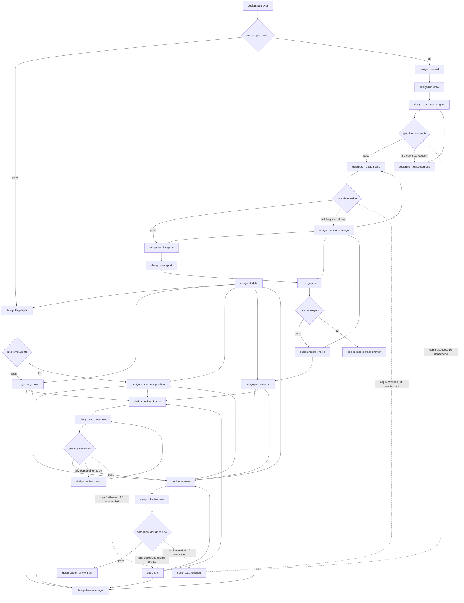

# 05 design: Design and build the CV

<!-- Hand-written text goes outside the generated blocks. `bun run render` (tools/workflow) rewrites only the lines between a block's start and end markers, from catalog.yaml and the stage.yaml files; edit the YAML, not a block. -->

<!-- generated:start summary -->

- **Stage:** 05 `design`, Design and build the CV. Facts: [`stage.yaml`](stage.yaml), 26 steps, 7 gates, 4 loops.
- **Purpose:** Turn the signed-off facts into the client's CV design and its build files: the Flagship for a Domain that has it, a custom composition when the data does not fit it, or a one-off Template from an Idea Run when the Domain has no Template; every client CV's design passes the design-reviewer and the codex-visual-reviewer.
- **Entry:** The client's Sign-off is saved and the draft stamped signed-off (stage text-draft).
- **Exit:** candidate.json and typst/cv.typ (with their design files and portrait) are in the Envelope, a fresh design-reviewer and a fresh codex-visual-reviewer passed the previews (or they reached the owner marked unresolved), and the builds/ previews are cleared.
- **Reads from:** [open](../01-open/README.md), [intake](../02-intake/README.md), [research](../03-research/README.md), [text-draft](../04-text-draft/README.md), [deliver](../06-deliver/README.md). **Hands to:** [deliver](../06-deliver/README.md).

<!-- generated:end summary -->

## Judgement

- **Design is the product.** A client CV must pass the `Batch Test`, the
  `Three-Second Test` and `Flagship Parity` (`docs/vision.md`, "Design is
  the product"); tidy but quiet is a failure, and the `design-reviewer`
  treats it as one (`gate.client-design-review`), with a
  `codex-visual-reviewer` beside it on the same pages
  ([P-0014](../../proposals/codex-visual-tools.md)). Every client CV goes
  through that review, Flagship CVs included (owner's decision #4 in
  [P-0017](../../proposals/workflow-model.md)).
- **The record comes from what the `Client` signed.** `design.fill-data`
  takes the facts from `intake/facts.md` and the wording from the
  signed-off draft; no new question to the `Client`, and no rewording
  beyond fitting the page.
- **No `Template` means a design first, not code first.** The `Idea Run`
  draws on fictional data for the `Client`'s `Domain`, specialty and
  `Rank`; the owner picks a `Style`, `Design Tier` and `Density`
  (`design.pick`), and may first look at the concepts, with their status,
  in the `Design Review` app; only then is the one-off `Template` built in
  the `Envelope` (`design.port-concept`). Its `typst/cv.typ` imports
  `/packages/cv-framework/lib.typ` only (ADR 0012), so render checks no
  schema; the design's other files (`presentation.json`, the `.typ` files
  in `designs/` and `text/`, the SVGs and images in `art/`, the portrait) are read by
  a path relative to `cv.typ`, and a `Revision` copies each one it finds.
- **The public engine changes only through code review.** A one-off's own
  design, wording and art stay in its `Envelope`; only what the engine
  alone can hold (today: a font render must find in the `Framework`'s
  fonts) goes through `design.engine-change` and a fresh `code-reviewer`
  (`gate.engine-review`, owner's decision #6).
- **Client pages leave `private/` only as previews.** `design.preview`
  compiles them into `builds/design-review-input-<timestamp>/` for the
  reviewer, who never reads `private/`. Its brief names the `Alias` only,
  the `Domain`, specialty and `Rank`, the chosen concept folder, `Design
  Tier` and `Density` when there is one, and that the text is the
  signed-off text. The `codex-visual-reviewer` sends those pages to
  OpenAI: they carry the whole CV, name and portrait included, which the
  consent to AI tools covers (question 1, stage
  [intake](../02-intake/README.md)); its `--ephemeral` call keeps
  no copy in Codex's local sessions. Every report is stored verbatim in
  the `Envelope` as `reviews/design-NN.md` (Codex's as
  `reviews/design-NN-codex.md`), never under `archive/work-records/`, and
  `design.clear-review-input` deletes the previews, with both reviewers'
  page PNGs and sheets inside, by path when the loop ends.
- **When to stop:** a fresh `design-reviewer` and a fresh
  `codex-visual-reviewer` both return PASS (Codex `UNAVAILABLE`: the
  `design-reviewer` alone, noted in the `Envelope`'s `README.md`), or the cap of
  `loop.client-design-review` (5 rounds while the owner attends, 10
  unattended, unless he sets another) is reached and the design goes to
  the owner marked unresolved with the last reason (`design.cap-reached`).

## Branches

Two gates in a chain choose one of three build paths:

| `gate.template-exists` | `gate.template-fits` | Path | Writes `typst/cv.typ` |
|---|---|---|---|
| pass | pass | The Flagship | `design.entry-point` |
| pass | fail | A custom composition from the `Domain`'s components, plus a `Framework Gap` | `design.custom-composition`, `design.framework-gap` |
| fail | (not asked) | An `Idea Run`, the owner's pick, a one-off `Template`, plus a `Framework Gap` | `design.run-brief` to `design.port-concept`, `design.framework-gap` |

- **`design.fill-data` runs on every path.** It needs only the signed-off
  facts, so on the no-`Template` path it runs beside the `Idea Run`, and
  `design.port-concept` reads the `candidate.json` it wrote. The gate's
  pass goes to the fit check, not to the record.
- **The data does not fit the Flagship** (`gate.template-fits` fails, on
  one of the known cases its check names): the page is composed by hand
  from the same components, never from copied library code, and the
  reason goes in `docs/framework-gaps.md`, which is how the gap gets
  closed later.
- **The owner parks or rejects every concept** (`gate.owner-pick` fails):
  `design.record-other-answer` records it, and no source says what happens
  to the `Client`'s CV next ([`GAPS.md`](../GAPS.md), "Inferences").
  [P-0018](../../proposals/workflow-gaps.md) item 7 recommends a new
  `Idea Run` steered by his reasons, with the owner telling the `Client`
  of the delay; until he answers, the lead asks him.
- **The review finds problems** (`gate.client-design-review` fails):
  `design.fix`, a fresh reviewer, up to the cap. The `Idea Run`'s own two
  gates loop the same way (`loop.idea-research`, `loop.idea-design`).

## Common mistakes

- Starting a no-`Template` CV in Typst before the owner has picked a
  design.
- Giving the `magazine-editor` or a reviewer anything from `private/`:
  briefs carry the `Alias`, the `Domain`, specialty and `Rank` only.
- Leaving `builds/design-review-input-*` behind: they hold a real
  `Client`'s pages outside `private/`.
- Copying library code into the `Envelope`, or changing the engine for
  one `Client` without the code review.
- Fitting an overflow by shrinking the type (constitution section 4): the
  page plan changes instead.
- Skipping the design review because the Flagship "is already approved".

## Reference detail

- `docs/guides/build-a-cv.md` sections 1-2 (the entry point and the
  record) and 5 (the custom composition).
- The `new-cv` skill: the checklist, by step ID, with the preview
  command; the `idea-run` skill; `docs/engine/layout-and-pagination.md`
  for page plans; `docs/framework-gaps.md` for the known gaps.

## Diagram

<!-- generated:start diagram -->

<!-- generated:end diagram -->

## Steps

<!-- generated:start steps -->

| ID | Name | Actor | Action | Inputs | Outputs | Gate | When |
|---|---|---|---|---|---|---|---|
| `design.handover` | Hand over to new-cv | `actor.lead` | `skill.new-cv` | `art.facts-final`, `art.decisions-md`, `art.draft-pdf`, `art.draft-meta`, `art.sign-off-png` | `art.readme-cv-record` | `gate.template-exists` |  |
| `design.run-brief` | Start an Idea Run for the client's Domain | `actor.lead` | `skill.idea-run` | `art.envelope-json`, `art.decisions-md` | `art.run-md` |  | The client's Domain has no Template. |
| `design.run-draw` | Draw three Styles in two Densities and three Design Tiers | `actor.magazine-editor` | `agent.magazine-editor` | `art.run-md` | `art.concept-brief`, `art.concept-pdf`, `art.concept-meta` |  | The client's Domain has no Template. |
| `design.run-research-gate` | A fresh research-reviewer checks the references | `actor.research-reviewer` | `agent.research-reviewer` | `art.concept-brief` | `art.idea-research-review` | `gate.idea-research` | The client's Domain has no Template. |
| `design.run-revise-sources` | The editor revises the references | `actor.magazine-editor` | `agent.magazine-editor-revise` | `art.idea-research-review` | `art.concept-brief` |  | The research gate returned FINDINGS. |
| `design.run-design-gate` | A fresh design-reviewer and codex-visual-reviewer judge every page | `actor.design-reviewer` | `agent.design-reviewer` | `art.concept-pdf`, `art.idea-research-review` | `art.idea-design-review` | `gate.idea-design` | The client's Domain has no Template. |
| `design.run-revise-design` | The editor revises the designs | `actor.magazine-editor` | `agent.magazine-editor-revise` | `art.idea-design-review` | `art.concept-pdf`, `art.concept-meta` |  | The quality gate returned FINDINGS. |
| `design.run-integrate` | Check the Meta Files, commit and merge the run | `actor.lead` | `lead.integrate-run` | `art.concept-pdf`, `art.concept-meta`, `art.idea-design-review` | `art.concepts-readme` |  | The client's Domain has no Template. |
| `design.run-report` | Tell the owner what the run drew | `actor.lead` | `lead.report-run` | `art.concepts-readme` | `art.run-message` |  | The client's Domain has no Template. |
| `design.pick` | The owner picks a Style, Design Tier and Density | `actor.owner` | `manual.pick-design` | `art.run-message`, `art.concept-pdf` | `art.owner-pick` | `gate.owner-pick` | The client's Domain has no Template. |
| `design.record-choice` | Record the choice and stamp the picked design chosen | `actor.lead` | `cmd.stamp-concept-status` | `art.owner-pick`, `art.concept-pdf` | `art.chosen-concept`, `art.concept-decision` |  |  |
| `design.record-other-answer` | Record a parked or rejected answer | `actor.lead` | `cmd.stamp-concept-status` | `art.owner-pick` | `art.concept-decision` |  | The owner parked or rejected the concepts. |
| `design.fill-data` | Write candidate.json and place the portrait | `actor.lead` | `lead.write-candidate-json` | `art.facts-final`, `art.draft-pdf`, `art.sign-off-png`, `art.documents`, `art.example-records` | `art.candidate-json`, `art.portrait` |  |  |
| `design.flagship-fit` | Check the data fits the Flagship | `actor.lead` | `lead.check-flagship-fit` | `art.candidate-json` |  | `gate.template-fits` | The client's Domain has a Template (today marine, the Flagship). |
| `design.entry-point` | Write the Flagship entry point | `actor.lead` | `lead.write-flagship-entry` | `art.candidate-json`, `art.flagship-template` | `art.cv-typ` |  | The data fits the Flagship. |
| `design.custom-composition` | Compose the page by hand | `actor.lead` | `lead.compose-by-hand` | `art.candidate-json`, `art.flagship-template` | `art.cv-typ`, `art.typst-sources` |  | The data does not fit the Flagship (contract periods, a three-column certificate table, a skills block). |
| `design.port-concept` | Port the chosen concept into the Envelope | `actor.lead` | `lead.port-concept` | `art.chosen-concept`, `art.candidate-json` | `art.cv-typ`, `art.typst-sources` |  | The client's Domain has no Template and the owner chose a concept. |
| `design.framework-gap` | Record the Framework Gap | `actor.lead` | `lead.record-framework-gap` | `art.cv-typ` | `art.framework-gap-entry`, `art.readme-cv-record` |  | A custom composition or a one-off Template was built. |
| `design.engine-change` | Change the public engine for the design | `actor.lead` | `lead.change-engine` | `art.cv-typ` | `art.engine-change` |  | The client's design needs something only the public engine can hold (fonts render finds only in packages/cv-framework/fonts/). |
| `design.engine-review` | A fresh code-reviewer reviews the engine change | `actor.code-reviewer` | `agent.code-reviewer` | `art.engine-change` | `art.engine-review-report` | `gate.engine-review` | The client's design needs something only the public engine can hold (fonts render finds only in packages/cv-framework/fonts/). |
| `design.engine-revise` | Fix the engine change | `actor.lead` | `lead.revise-engine-change` | `art.engine-review-report` | `art.engine-change` |  | The code review returned FINDINGS. |
| `design.preview` | Compile the previews for the reviewer | `actor.lead` | `lead.compile-previews` | `art.cv-typ`, `art.candidate-json`, `art.framework-fonts` | `art.design-review-input` |  |  |
| `design.client-review` | A fresh design-reviewer and codex-visual-reviewer judge the client's pages | `actor.design-reviewer` | `agent.design-reviewer` | `art.design-review-input` | `art.design-review-report` | `gate.client-design-review` |  |
| `design.fix` | Fix the design on the findings | `actor.lead` | `lead.fix-design` | `art.design-review-report` | `art.cv-typ` |  | The design review returned FINDINGS. |
| `design.clear-review-input` | Clear the previews from builds/ | `actor.lead` | `lead.clear-review-input` | `art.design-review-report` |  |  |  |
| `design.cap-reached` | At a loop's cap, the owner decides | `actor.owner` | `manual.decide-at-cap` |  |  |  |  |

<!-- generated:end steps -->

## Gates

<!-- generated:start gates -->

| ID | Name | Checked by | Check | Pass | Fail |
|---|---|---|---|---|---|
| `gate.template-exists` | The Domain has a Template | `design.handover` | The client's Domain already has a Template (today only marine, the Flagship). | `design.flagship-fit` | `design.run-brief` |
| `gate.template-fits` | The data fits the Flagship | `design.flagship-fit` | The client's data fits flagship: whole service months, no three-column certificate table, no skills block (the known cases in docs/framework-gaps.md). | `design.entry-point` | `design.custom-composition` |
| `gate.idea-research` | Idea Run research gate | `design.run-research-gate` | A fresh research-reviewer returns PASS on the references in each brief.md. | `design.run-design-gate` | `design.run-revise-sources` |
| `gate.idea-design` | Idea Run quality gate | `design.run-design-gate` | A fresh design-reviewer and a fresh codex-visual-reviewer both return PASS; failing the Batch Test, the Three-Second Test or Flagship Parity is Blocking. | `design.run-integrate` | `design.run-revise-design` |
| `gate.owner-pick` | The owner builds a concept | `design.pick` | The owner answered "Build it" with a Style, Design Tier and Density. | `design.record-choice` | `design.record-other-answer` |
| `gate.engine-review` | Engine change review | `design.engine-review` | A fresh code-reviewer returns PASS (no Blocking or Material finding) on the engine change. | `design.preview` | `design.engine-revise` |
| `gate.client-design-review` | Client design review | `design.client-review` | A fresh design-reviewer and a fresh codex-visual-reviewer both return PASS on the client's preview pages, first on the Batch Test and the Three-Second Test. | `design.clear-review-input` | `design.fix` |

<!-- generated:end gates -->

## Loops

<!-- generated:start loops -->

| ID | Name | Gate | Cap | At the cap |
|---|---|---|---|---|
| `loop.idea-research` | Idea Run research rounds | `gate.idea-research` | 5 attended, 10 unattended | `design.cap-reached` |
| `loop.idea-design` | Idea Run quality rounds | `gate.idea-design` | 5 attended, 10 unattended | `design.cap-reached` |
| `loop.engine-review` | Engine change review rounds | `gate.engine-review` | 5 attended, 10 unattended | `design.cap-reached` |
| `loop.client-design-review` | Client design review rounds | `gate.client-design-review` | 5 attended, 10 unattended | `design.cap-reached` |

<!-- generated:end loops -->

## Artifacts

<!-- generated:start artifacts -->

| ID | Name | Path | Visibility | Made by |
|---|---|---|---|---|
| `art.candidate-json` | candidate.json | `private/<envelope>/candidate.json` | private | `design.fill-data`, `deliver.fix` |
| `art.chosen-concept` | The design the owner picked | `studio/design-concepts/<date>-<slug>/<density>/<tier>/` | public | `design.record-choice` |
| `art.concept-brief` | A Style's brief | `studio/design-concepts/<date>-<slug>/brief.md` | public | `design.run-draw`, `design.run-revise-sources` |
| `art.concept-decision` | The owner's answer, recorded | `studio/design-concepts/README.md` | public | `design.record-choice`, `design.record-other-answer` |
| `art.concept-meta` | A concept's Meta File | `studio/design-concepts/<date>-<slug>/<density>/<tier>/<density>-<tier>.meta.json` | public | `design.run-draw`, `design.run-revise-design` |
| `art.concept-pdf` | A concept design | `studio/design-concepts/<date>-<slug>/<density>/<tier>/<density>-<tier>.pdf` | public | `design.run-draw`, `design.run-revise-design` |
| `art.concepts-readme` | The concepts index | `studio/design-concepts/README.md` | public | `design.run-integrate` |
| `art.cv-typ` | The CV's entry point | `private/<envelope>/typst/cv.typ` | private | `design.entry-point`, `design.custom-composition`, `design.port-concept`, `design.fix`, `deliver.fix` |
| `art.decisions-md` | CV Decisions (decisions.md) | `private/<envelope>/research/decisions.md` | private | `research.decisions`, `research.decisions-update` |
| `art.design-review-input` | The client's preview pages for the reviewer | `builds/design-review-input-<timestamp>/` | ephemeral | `design.preview` |
| `art.design-review-report` | A client design review report | `private/<envelope>/reviews/design-NN.md` | private | `design.client-review` |
| `art.documents` | The client's documents | `private/<envelope>/intake/documents/` | private | `intake.capture` |
| `art.draft-meta` | The Text Draft's Meta File | `private/<envelope>/draft/draft-NN.meta.json` | private | `text-draft.draft-compile`, `text-draft.draft-sent`, `text-draft.draft-supersede`, `text-draft.sign-off-stamp` |
| `art.draft-pdf` | Text Draft PDF | `private/<envelope>/draft/draft-NN.pdf` | private | `text-draft.draft-compile` |
| `art.engine-change` | A change to the public engine | `packages/` | public | `design.engine-change`, `design.engine-revise` |
| `art.engine-review-report` | The engine change's review report | `archive/work-records/<task-slug>/reviews/NN-<reviewer>.md` | public | `design.engine-review` |
| `art.envelope-json` | envelope.json | `private/<envelope>/envelope.json` | private | `open.envelope-json` |
| `art.example-records` | The fictional example records | `examples/candidates/` | public | given |
| `art.facts-final` | facts.md, final | `private/<envelope>/intake/facts.md` | private | `research.facts-update`, `text-draft.corrections` |
| `art.flagship-template` | The Flagship Template | `packages/domains/marine/templates/flagship/` | public | given |
| `art.framework-fonts` | The bundled fonts | `packages/cv-framework/fonts/` | public | given |
| `art.framework-gap-entry` | A Framework Gap entry | `docs/framework-gaps.md` | public | `design.framework-gap` |
| `art.idea-design-review` | An Idea Run quality report | `archive/work-records/idea-runs/<run>/reviews/NN-design-reviewer.md` | public | `design.run-design-gate` |
| `art.idea-research-review` | An Idea Run research report | `archive/work-records/idea-runs/<run>/reviews/NN-research-reviewer.md` | public | `design.run-research-gate` |
| `art.owner-pick` | The owner's answer on the concepts |  | ephemeral | `design.pick` |
| `art.portrait` | The client's portrait | `private/<envelope>/images/portrait/` | private | `design.fill-data` |
| `art.readme-cv-record` | README.md, what was decided and where the evidence is | `private/<envelope>/README.md` | private | `design.handover`, `design.framework-gap` |
| `art.run-md` | The Idea Run record | `archive/work-records/idea-runs/<date>-editor/run.md` | public | `design.run-brief` |
| `art.run-message` | The run's message to the owner |  | ephemeral | `design.run-report` |
| `art.sign-off-png` | The Sign-off screenshot | `private/<envelope>/draft/sign-off-NN.png` | private | `text-draft.sign-off-save` |
| `art.typst-sources` | The design's own files beside cv.typ | `private/<envelope>/typst/` | private | `design.custom-composition`, `design.port-concept` |

<!-- generated:end artifacts -->

## Actions

<!-- generated:start actions -->

| ID | Kind | Name | Runs |
|---|---|---|---|
| `agent.code-reviewer` | agent | A fresh code-reviewer round | agent `code-reviewer` |
| `agent.design-reviewer` | agent | A fresh design-reviewer round | agent `design-reviewer` |
| `agent.magazine-editor` | agent | The magazine-editor draws | agent `magazine-editor` |
| `agent.magazine-editor-revise` | agent | The same magazine-editor, by SendMessage | agent `magazine-editor` |
| `agent.research-reviewer` | agent | A fresh research-reviewer round | agent `research-reviewer` |
| `cmd.stamp-concept-status` | cmd | Stamp a concept's new state | `python scripts/outputs.py stamp <pdf> status=<state>` |
| `lead.change-engine` | lead | Change the engine | Makes the engine change the design needs on a branch, for the normal code-reviewer gate; the one-off's own assets stay in its Envelope. |
| `lead.check-flagship-fit` | lead | Check the Flagship fit | Checks the data against the known Flagship gaps listed in docs/framework-gaps.md. |
| `lead.clear-review-input` | lead | Clear the previews | Deletes the builds/design-review-input-* folders by path, with the page PNGs and batch sheets both reviewers made inside them, since they hold a real client's pages outside private/ (never git clean -x or -X). |
| `lead.compile-previews` | lead | Compile the previews | Compiles typst/cv.typ into builds/design-review-input-<timestamp>/cv.pdf with the typst compile line in the new-cv skill, since the reviewer never reads private/. |
| `lead.compose-by-hand` | lead | Compose by hand | Writes typst/cv.typ from the lib.typ components (core-components, flagship-components), with data the schema cannot hold in typst/presentation.json, every file read by a literal relative path. |
| `lead.fix-design` | lead | Fix the design | Fixes the design on the findings and stores both reports verbatim, as reviews/design-NN.md and reviews/design-NN-codex.md, before the next fresh round. |
| `lead.integrate-run` | lead | Integrate the Idea Run | Runs python scripts/outputs.py check (every design carries its Meta File), then commits, merges to main and pushes; concepts stay proposed. |
| `lead.port-concept` | lead | Port the chosen concept | Builds the one-off Template in the Envelope from the chosen concept's Typst: typst/cv.typ importing /packages/cv-framework/lib.typ only, the design code in typst/designs/, the wording in typst/text/, the SVGs in typst/art/. |
| `lead.record-framework-gap` | lead | Record the Framework Gap | Adds an entry to docs/framework-gaps.md (what was needed, what was gone around, what was built) and records the reason in the Envelope's README.md. |
| `lead.report-run` | lead | Report the run to the owner | Sends the short message with each Style's six PDFs and lists the concepts still waiting in the session-handoff doc. |
| `lead.revise-engine-change` | lead | Fix the engine change | Fixes the Blocking and Material findings and reruns the affected checks before the next fresh round. |
| `lead.write-candidate-json` | lead | Write candidate.json | Copies the closest example record and replaces every value from the facts and the signed-off wording (whole months, never months invented from calendar periods), replaces the fictional disclosure, and places the portrait in images/portrait/. |
| `lead.write-flagship-entry` | lead | Write the Flagship entry point | Writes typst/cv.typ importing the engine by root-absolute path: role, theme, artwork, the durations switch and a pages override with this client's company indices (or the one-page profile), and the client's copy in place of the example wording. |
| `manual.decide-at-cap` | manual | The owner decides at the cap | At a loop's cap (a review loop, the client's draft corrections, the owner's own changes or a render that keeps failing) the lead stops and brings the owner the open item with its last reason; another round needs his decision. |
| `manual.pick-design` | manual | Pick the design | The owner answers Build it (with a Style, Design Tier and Density), Later, or Reject. |
| `skill.idea-run` | skill | Run the idea-run skill (design concepts) | skill `idea-run` |
| `skill.new-cv` | skill | Run the new-cv skill | skill `new-cv` |

<!-- generated:end actions -->
