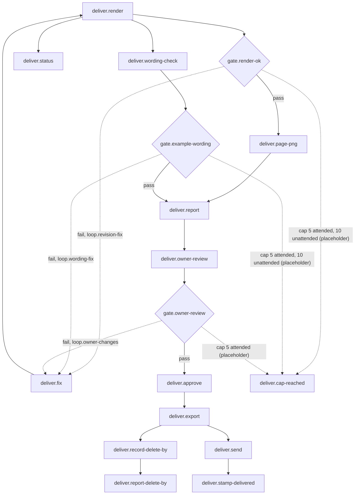

# 06 deliver: Render, Approval, Export and delivery

<!-- Hand-written text goes outside the generated blocks. `bun run render` (tools/workflow) rewrites only the lines between a block's start and end markers, from catalog.yaml and the stage.yaml files; edit the YAML, not a block. -->

<!-- generated:start summary -->

- **Stage:** 06 `deliver`, Render, Approval, Export and delivery. Facts: [`stage.yaml`](stage.yaml), 14 steps, 3 gates, 3 loops.
- **Purpose:** Render the CV as a Revision, check it, let the owner approve its exact bytes, export a verified copy, write the delete-by date, and record the delivery once the owner has sent it.
- **Entry:** The Envelope holds candidate.json and typst/cv.typ, and the design review passed (stage design).
- **Exit:** The approved Revision is exported to exports/<revision>/, README.md says when it was exported and when to delete it, and after the owner sent it the Revision's Meta File says delivered.
- **Reads from:** [open](../01-open/README.md), [design](../05-design/README.md). **Hands to:** [design](../05-design/README.md), [after](../07-after/README.md).

<!-- generated:end summary -->

<!-- generated:start diagram -->

<!-- generated:end diagram -->

<!-- generated:start steps -->

| ID | Name | Actor | Action | Inputs | Outputs | Gate | When |
|---|---|---|---|---|---|---|---|
| `deliver.render` | Render a Revision | `actor.lead` | `cmd.cv-render` | `art.envelope-json`, `art.candidate-json`, `art.cv-typ`, `art.engine` | `art.revision-inputs`, `art.render-log`, `art.render-json`, `art.checks-json`, `art.cv-pdf`, `art.cv-meta`, `art.render-summary` | `gate.render-ok` |  |
| `deliver.fix` | Fix the inputs; the fix is a new Revision | `actor.lead` | `lead.fix-inputs` | `art.render-summary` | `art.cv-typ`, `art.candidate-json` |  | The render was refused or failed, the wording check found example wording, or the owner asked for a change. |
| `deliver.page-png` | Render every page to PNG and look at it | `actor.lead` | `cmd.page-png` | `art.cv-pdf` | `art.page-png` |  |  |
| `deliver.wording-check` | Check for the fictional example wording | `actor.lead` | `cmd.wording-check` | `art.cv-pdf` | `art.wording-hits` | `gate.example-wording` |  |
| `deliver.report` | Report the Revision to the owner | `actor.lead` | `lead.report-render` | `art.render-summary`, `art.page-png`, `art.wording-hits` | `art.render-report` |  |  |
| `deliver.owner-review` | The owner reviews the exact cv.pdf | `actor.owner` | `manual.review-pdf` | `art.render-report`, `art.cv-pdf` | `art.reviewed-hash` | `gate.owner-review` |  |
| `deliver.approve` | The owner approves the reviewed bytes | `actor.owner` | `cmd.cv-approve` | `art.cv-pdf`, `art.render-json`, `art.checks-json`, `art.reviewed-hash`, `art.envelope-json` | `art.approval-json`, `art.cv-meta` |  |  |
| `deliver.export` | Export the approved Revision | `actor.lead` | `cmd.cv-export` | `art.approval-json`, `art.cv-pdf`, `art.render-json`, `art.checks-json` | `art.export-bundle` |  |  |
| `deliver.record-delete-by` | Write the Export and delete-by dates in README.md | `actor.lead` | `lead.write-delete-by` | `art.export-bundle` | `art.readme-delete-by` |  |  |
| `deliver.send` | The owner sends the exported PDF | `actor.owner` | `manual.send-pdf` | `art.export-bundle` | `art.delivery-message` |  |  |
| `deliver.stamp-delivered` | Stamp the Revision delivered | `actor.lead` | `cmd.stamp-delivered` | `art.delivery-message`, `art.export-bundle`, `art.approval-json` | `art.cv-meta` |  |  |
| `deliver.report-delete-by` | Name the delete-by date to the owner | `actor.lead` | `lead.report-delete-by` | `art.readme-delete-by` | `art.delete-by-note` |  |  |
| `deliver.status` | List the Revisions and their states | `actor.lead` | `cmd.cv-status` | `art.render-json` | `art.status-listing` |  | Any time the state of the Revisions is needed. |
| `deliver.cap-reached` | At a loop's cap, the owner decides | `actor.owner` | `manual.decide-at-cap` |  |  |  |  |

<!-- generated:end steps -->

<!-- generated:start gates -->

| ID | Name | Checked by | Check | Pass | Fail |
|---|---|---|---|---|---|
| `gate.render-ok` | Render done | `deliver.render` | scripts/cv.py render exits 0: not refused (exit 2, nothing written), the compile succeeded and every check passed (exit 1 keeps the Revision). | `deliver.page-png` | `deliver.fix` |
| `gate.example-wording` | No example wording | `deliver.wording-check` | The rendered text contains none of "fictional", "illustrative" and "flagship" (the one exception: "flagship" in the client's own words, once the footer shows the configured brand). | `deliver.report` | `deliver.fix` |
| `gate.owner-review` | The owner accepts the Revision | `deliver.owner-review` | The owner reviewed this Revision's cv.pdf and wants no change. | `deliver.approve` | `deliver.fix` |

<!-- generated:end gates -->

<!-- generated:start loops -->

| ID | Name | Gate | Cap | At the cap |
|---|---|---|---|---|
| `loop.revision-fix` | Fix and render again after a failed render (placeholder cap) | `gate.render-ok` | 5 attended, 10 unattended, **placeholder** ([GAPS.md](../GAPS.md)) | `deliver.cap-reached` |
| `loop.wording-fix` | Fix and render again after example wording (placeholder cap) | `gate.example-wording` | 5 attended, 10 unattended, **placeholder** ([GAPS.md](../GAPS.md)) | `deliver.cap-reached` |
| `loop.owner-changes` | The owner's changes, as new Revisions (placeholder cap) | `gate.owner-review` | 5 attended, **placeholder** ([GAPS.md](../GAPS.md)) | `deliver.cap-reached` |

<!-- generated:end loops -->

<!-- generated:start artifacts -->

| ID | Name | Path | Visibility | Made by |
|---|---|---|---|---|
| `art.approval-json` | The approval receipt | `private/<envelope>/revisions/<revision>/cv.approval.json` | private | `deliver.approve` |
| `art.candidate-json` | candidate.json | `private/<envelope>/candidate.json` | private | `design.fill-data`, `deliver.fix` |
| `art.checks-json` | checks.json | `private/<envelope>/revisions/<revision>/checks.json` | private | `deliver.render` |
| `art.cv-meta` | The Revision's Meta File | `private/<envelope>/revisions/<revision>/cv.meta.json` | private | `deliver.render`, `deliver.approve`, `deliver.stamp-delivered` |
| `art.cv-pdf` | The Revision's cv.pdf | `private/<envelope>/revisions/<revision>/cv.pdf` | private | `deliver.render` |
| `art.cv-typ` | The CV's entry point | `private/<envelope>/typst/cv.typ` | private | `design.entry-point`, `design.custom-composition`, `design.port-concept`, `design.fix`, `deliver.fix` |
| `art.delete-by-note` | The delete-by date, named to the owner |  | ephemeral | `deliver.report-delete-by` |
| `art.delivery-message` | The CV sent to the client |  | third-party | `deliver.send` |
| `art.engine` | The public engine | `packages/` | public | given |
| `art.envelope-json` | envelope.json | `private/<envelope>/envelope.json` | private | `open.envelope-json` |
| `art.export-bundle` | The Export | `private/<envelope>/exports/<revision>/` | private | `deliver.export` |
| `art.page-png` | The page PNGs | `builds/<new-folder>/cv-p<N>.png` | ephemeral | `deliver.page-png` |
| `art.readme-delete-by` | README.md, the Export and delete-by line | `private/<envelope>/README.md` | private | `deliver.record-delete-by` |
| `art.render-json` | render.json | `private/<envelope>/revisions/<revision>/render.json` | private | `deliver.render` |
| `art.render-log` | render.log | `private/<envelope>/revisions/<revision>/render.log` | private | `deliver.render` |
| `art.render-report` | The render report to the owner |  | ephemeral | `deliver.report` |
| `art.render-summary` | What render prints |  | ephemeral | `deliver.render` |
| `art.reviewed-hash` | The hash the owner reviewed |  | ephemeral | `deliver.owner-review` |
| `art.revision-inputs` | The Revision's input snapshot | `private/<envelope>/revisions/<revision>/inputs/` | private | `deliver.render` |
| `art.status-listing` | What status prints |  | ephemeral | `deliver.status` |
| `art.wording-hits` | The wording check's result |  | ephemeral | `deliver.wording-check` |

<!-- generated:end artifacts -->

<!-- generated:start actions -->

| ID | Kind | Name | Runs |
|---|---|---|---|
| `cmd.cv-approve` | cmd | Approve a Revision | `python scripts/cv.py approve private/<envelope> <revision> --approver "<name>" --sha256 <reviewed hash>` |
| `cmd.cv-export` | cmd | Export a Revision | `python scripts/cv.py export private/<envelope> <revision>` |
| `cmd.cv-render` | cmd | Render a Revision | `python scripts/cv.py render private/<envelope> [--pages <N>] [--input <key>=<value> ...]` |
| `cmd.cv-status` | cmd | List the Revisions | `python scripts/cv.py status private/<envelope>` |
| `cmd.page-png` | cmd | Render a page to PNG | `python -c "import pymupdf; doc = pymupdf.open('private/<envelope>/revisions/<revision>/cv.pdf'); doc[<N>].get_pixmap(dpi=96).save('builds/<new-folder>/cv-p<N>.png')"` |
| `cmd.stamp-delivered` | cmd | Stamp the Revision delivered | `python scripts/outputs.py stamp private/<envelope>/revisions/<revision>/cv.pdf status=delivered` |
| `cmd.wording-check` | cmd | Check for example wording | `python -c "import pymupdf,sys; t=''.join(p.get_text() for p in pymupdf.open(sys.argv[1])).lower(); print([w for w in ('fictional','illustrative','flagship') if w in t])" private/<envelope>/revisions/<revision>/cv.pdf` |
| `lead.fix-inputs` | lead | Fix the inputs | Applies the fix the message names, in candidate.json or the entry point's layout override; never shrinks the body font; the Revision it looked at is never modified. |
| `lead.report-delete-by` | lead | Name the delete-by date | Names the delete-by date in its report to the owner, with any Intake Form, Sheet and script project listed in README.md for deletion with it. |
| `lead.report-render` | lead | Report the render | Stops at the render and reports the revision folder, the PDF hash, the page count, what was checked on each page, any override, and every WARNING and NOTE word for word. |
| `lead.write-delete-by` | lead | Write the delete-by date | Writes "Exported <date>, delete by <date + 12 months>" in the Envelope's README.md, together with the Export. |
| `manual.decide-at-cap` | manual | The owner decides at the cap | At a loop's cap (a review loop, the client's draft corrections, the owner's own changes or a render that keeps failing) the lead stops and brings the owner the open item with its last reason; another round needs his decision. |
| `manual.review-pdf` | manual | Review the PDF | The owner opens revisions/<revision>/cv.pdf (or finds it in the Design Review app), weighs the certificate warnings, and approves it or asks for a change. |
| `manual.send-pdf` | manual | Send the PDF | The owner sends exports/<revision>/cv.pdf to the client, a separate manual act; the receipt is internal and not sent. |

<!-- generated:end actions -->
