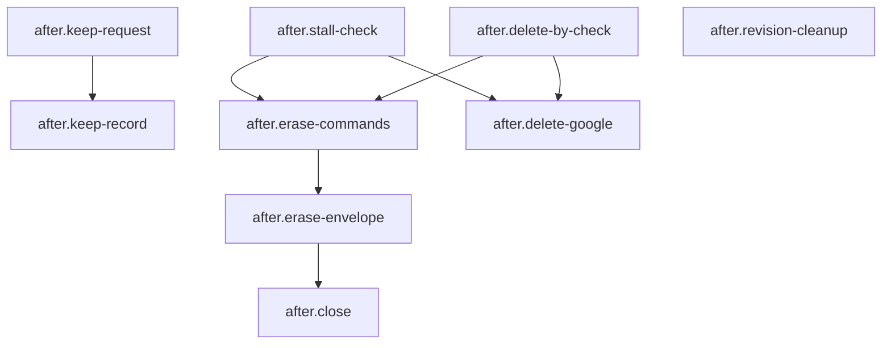

# 07 after: Retention, deletion and closing the record

<!-- Hand-written text goes outside the generated blocks. `bun run render` (tools/workflow) rewrites only the lines between a block's start and end markers, from catalog.yaml and the stage.yaml files; edit the YAML, not a block. -->

<!-- generated:start summary -->

- **Stage:** 07 `after`, Retention, deletion and closing the record. Facts: [`stage.yaml`](stage.yaml), 9 steps, 0 gates, 0 loops.
- **Purpose:** Keep a client's data only as long as promised: name stalled clients and passed delete-by dates to the owner, honour a request to keep, have the owner erase the Envelope and its Google items, and close the client's task.
- **Entry:** The new-client skill runs (the stall and delete-by checks run every time), or a client's delete-by date, written at Export, has passed.
- **Exit:** The Envelope is gone from private/ and from the private repository's history, the Google items are deleted, and the client's task is closed; or envelope.json records the client's request to keep his data.
- **Reads from:** [open](../01-open/README.md), [intake](../02-intake/README.md), [deliver](../06-deliver/README.md). **Hands to:** none.

<!-- generated:end summary -->

<!-- generated:start diagram -->

<!-- generated:end diagram -->

<!-- generated:start steps -->

| ID | Name | Actor | Action | Inputs | Outputs | Gate | When |
|---|---|---|---|---|---|---|---|
| `after.stall-check` | Name stalled clients to the owner | `actor.lead` | `skill.new-client` | `art.envelope-readme` | `art.retention-report` |  | Every time the new-client skill runs. |
| `after.delete-by-check` | Name passed delete-by dates to the owner | `actor.lead` | `skill.new-client` | `art.readme-delete-by` | `art.retention-report` |  | Every time the new-client skill runs. |
| `after.keep-request` | The client asks to keep his data | `actor.client` | `manual.ask-to-keep` | `art.intake-message` | `art.keep-request` |  | The client asks to keep his data beyond the delete-by date. |
| `after.keep-record` | Record the keep request in envelope.json | `actor.lead` | `lead.record-keep-request` | `art.keep-request` | `art.envelope-keep` |  | The client asked to keep his data. |
| `after.erase-commands` | Hand the owner the history-erase commands | `actor.lead` | `lead.fill-erase-commands` | `art.retention-report` | `art.erase-commands` |  | The delete-by date has passed and envelope.json records no keep request, or the owner decides to delete a client who never reached Export (no consent, dropped out). |
| `after.delete-google` | Delete the Intake Forms, Sheets and script projects | `actor.owner` | `manual.delete-google-items` | `art.readme-google-links`, `art.retention-report` |  |  | The client had an Intake Form, and the delete-by date has passed with no keep request recorded, or the owner decides to delete a client who never reached Export (no consent, dropped out). |
| `after.erase-envelope` | Delete the Envelope and erase it from the private history | `actor.owner` | `manual.erase-envelope` | `art.erase-commands` | `art.private-history` |  | The delete-by date has passed and envelope.json records no keep request, or the owner decides to delete a client who never reached Export (no consent, dropped out). |
| `after.close` | Close the client's task | `actor.lead` | `lead.close-client-task` | `art.private-history` | `art.client-task` |  |  |
| `after.revision-cleanup` | Remove failed or unapproved Revisions | `actor.owner` | `manual.go-remove-revisions` | `art.status-listing` |  |  | The owner wants failed or unapproved Revisions removed before the delete-by date. |

<!-- generated:end steps -->

<!-- generated:start gates -->

No gates in this stage.

<!-- generated:end gates -->

<!-- generated:start loops -->

No loops in this stage.

<!-- generated:end loops -->

<!-- generated:start artifacts -->

| ID | Name | Path | Visibility | Made by |
|---|---|---|---|---|
| `art.client-task` | The client's Backlog.md task | `backlog/tasks/` | public | `open.task-create`, `after.close` |
| `art.envelope-keep` | envelope.json, the keep request | `private/<envelope>/envelope.json` | private | `after.keep-record` |
| `art.envelope-readme` | The Envelope's README.md (Alias and intake date) | `private/<envelope>/README.md` | private | `open.alias` |
| `art.erase-commands` | The filled history-erase commands |  | ephemeral | `after.erase-commands` |
| `art.intake-message` | The questions in the client's chat |  | third-party | `intake.relay-send` |
| `art.keep-request` | The client's request to keep his data |  | third-party | `after.keep-request` |
| `art.private-history` | The private repository without the Envelope |  | third-party | `after.erase-envelope` |
| `art.readme-delete-by` | README.md, the Export and delete-by line | `private/<envelope>/README.md` | private | `deliver.record-delete-by` |
| `art.readme-google-links` | README.md, section "Google" | `private/<envelope>/README.md` | private | `intake.form-links` |
| `art.retention-report` | Stalled clients and passed delete-by dates, by Alias |  | ephemeral | `after.stall-check`, `after.delete-by-check` |
| `art.status-listing` | What status prints |  | ephemeral | `deliver.status` |

<!-- generated:end artifacts -->

<!-- generated:start actions -->

| ID | Kind | Name | Runs |
|---|---|---|---|
| `lead.close-client-task` | lead | Close the client's task | Closes the client's Backlog.md task once the Envelope is deleted. |
| `lead.fill-erase-commands` | lead | Fill in the erase commands | Gives the owner the guide's history-erase commands filled in with the Envelope's folder name; he runs them, the lead never does. |
| `lead.record-keep-request` | lead | Record the keep request | Records the client's keep request as a field in envelope.json, so the delete-by check skips this client. |
| `manual.ask-to-keep` | manual | Ask to keep the data | The client asks, through the owner, that his details be kept beyond 12 months after delivery. |
| `manual.delete-google-items` | manual | Delete the Google items | The owner deletes each Intake Form, its Sheet and its script project listed in README.md, then empties the Drive Trash. |
| `manual.erase-envelope` | manual | Erase the Envelope | With git status and git log origin/main.. empty in private/, the owner runs the erase in a fresh clone (git filter-repo, force-push), then deletes that folder and every clone, private/ included, and clones it again. |
| `manual.go-remove-revisions` | manual | Give the go to remove Revisions | The owner gives his explicit go, on the exact command shown first, to remove failed or unapproved Revisions. |
| `skill.new-client` | skill | The new-client skill's report to the owner | skill `new-client` |

<!-- generated:end actions -->
