# The client workflow

<!-- Hand-written text goes outside the generated blocks. `bun run render` (tools/workflow) rewrites only the lines between a block's start and end markers, from catalog.yaml and the stage.yaml files; edit the YAML, not a block. -->

<!-- generated:start stages -->

| # | Stage | Name | Steps | Gates | Loops | Reads from | Hands to |
|---|---|---|---|---|---|---|---|
| 01 | [open](01-open/README.md) | Open the Envelope | 5 | 0 | 0 |  | [intake](02-intake/README.md), [research](03-research/README.md), [text-draft](04-text-draft/README.md), [design](05-design/README.md), [deliver](06-deliver/README.md), [after](07-after/README.md) |
| 02 | [intake](02-intake/README.md) | Intake by Relay | 15 | 1 | 0 | [open](01-open/README.md) | [research](03-research/README.md), [design](05-design/README.md), [after](07-after/README.md) |
| 03 | [research](03-research/README.md) | Facts, Scout, CV Decisions, Deep Dives and one follow-up | 23 | 4 | 3 | [open](01-open/README.md), [intake](02-intake/README.md) | [text-draft](04-text-draft/README.md), [design](05-design/README.md) |
| 04 | [text-draft](04-text-draft/README.md) | Text Draft and Sign-off | 12 | 1 | 1 | [open](01-open/README.md), [research](03-research/README.md) | [design](05-design/README.md) |
| 05 | [design](05-design/README.md) | Design and build the CV | 26 | 7 | 4 | [open](01-open/README.md), [intake](02-intake/README.md), [research](03-research/README.md), [text-draft](04-text-draft/README.md), [deliver](06-deliver/README.md) | [deliver](06-deliver/README.md) |
| 06 | [deliver](06-deliver/README.md) | Render, Approval, Export and delivery | 14 | 3 | 3 | [open](01-open/README.md), [design](05-design/README.md) | [design](05-design/README.md), [after](07-after/README.md) |
| 07 | [after](07-after/README.md) | Retention, deletion and closing the record | 9 | 0 | 0 | [open](01-open/README.md), [intake](02-intake/README.md), [deliver](06-deliver/README.md) |  |

```mermaid
flowchart LR
  st_open["01 open: Open the Envelope"]
  st_intake["02 intake: Intake by Relay"]
  st_research["03 research: Facts, Scout, CV Decisions, Deep Dives and one follow-up"]
  st_text_draft["04 text-draft: Text Draft and Sign-off"]
  st_design["05 design: Design and build the CV"]
  st_deliver["06 deliver: Render, Approval, Export and delivery"]
  st_after["07 after: Retention, deletion and closing the record"]
  %% An arrow implied by a longer path (not through an optional step) is left out; the tables list every input and handover.
  st_open -->|"1 artifact"| st_intake
  st_intake -->|"2 artifacts, 1 branch"| st_research
  st_research -->|"2 artifacts"| st_text_draft
  st_text_draft -->|"4 artifacts"| st_design
  st_design -->|"2 artifacts"| st_deliver
  st_deliver -.->|"2 artifacts"| st_design
  st_deliver -->|"2 artifacts"| st_after
```

<!-- generated:end stages -->

<!-- generated:start journey -->

<!-- generated:end journey -->

<!-- generated:start handovers -->

| From | To | Artifacts | Branches |
|---|---|---|---|
| `open` | `intake` | `art.envelope-json` |  |
| `open` | `research` | `art.envelope-json` |  |
| `open` | `text-draft` | `art.envelope-json` |  |
| `open` | `design` | `art.envelope-json` |  |
| `open` | `deliver` | `art.envelope-json` |  |
| `open` | `after` | `art.envelope-readme` |  |
| `intake` | `research` | `art.documents`, `art.messages-md` | `gate.consent pass` |
| `intake` | `design` | `art.documents` |  |
| `intake` | `after` | `art.intake-message`, `art.readme-google-links` |  |
| `research` | `text-draft` | `art.decisions-md`, `art.facts-final` |  |
| `research` | `design` | `art.decisions-md`, `art.facts-final` |  |
| `text-draft` | `design` | `art.draft-meta`, `art.draft-pdf`, `art.facts-final`, `art.sign-off-png` |  |
| `design` | `deliver` | `art.candidate-json`, `art.cv-typ` |  |
| `deliver` | `design` | `art.candidate-json`, `art.cv-typ` |  |
| `deliver` | `after` | `art.readme-delete-by`, `art.status-listing` |  |

<!-- generated:end handovers -->

<!-- generated:start actors -->

| ID | Kind | Name | Does |
|---|---|---|---|
| `actor.client` | human | The client | Answers the question list and the one follow-up (by chat or an Intake Form), checks the underlined facts of the Text Draft and replies OK or with corrections, and may ask to keep his data. |
| `actor.code-reviewer` | agent | code-reviewer | Fresh per round: reviews a change to the public engine that a client's job needs; the only way such a change lands. |
| `actor.design-reviewer` | agent | design-reviewer | Fresh per round: judges the concept pages of an Idea Run and every client CV's preview pages, first on the Batch Test, the Three-Second Test and Flagship Parity. Never reads private/; renders only under builds/. |
| `actor.general-purpose` | agent | General-purpose agent | Claude Code's built-in agent: writes one Deep Dive per chosen question from a brief that names only the Alias, and revises it on the reviewer's findings. Writes no files. |
| `actor.lead` | lead | The lead (the main Claude Code session) | Writes every file of the Envelope, researches, briefs the subagents and runs their review loops, compiles and stamps, renders, runs Export after the owner's Approval, and reports to the owner. Never talks to the client and never approves a client's PDF. |
| `actor.magazine-editor` | agent | magazine-editor | Draws three Styles, each in two Densities and three Design Tiers, as Typst mock-ups on fictional data for the client's Domain, specialty and Rank, stamps each PDF proposed, and revises on the reviewers' findings. Never reads private/. |
| `actor.owner` | human | The owner | The only one who talks to the client: names a new client, relays every message both ways, picks the Deep Dives and the design, reviews and approves the client's PDF, sends it, and runs every deletion under private/ and in Google. |
| `actor.research-reviewer` | agent | research-reviewer | Fresh per round: checks that a Deep Dive's, a Research Library note's or a concept brief's sources exist, are current and say what is claimed. Never reads private/. |

<!-- generated:end actors -->
