# The client workflow

<!-- Hand-written text goes outside the generated blocks. `bun run render` (tools/workflow) rewrites only the lines between a block's start and end markers, from catalog.yaml and the stage.yaml files; edit the YAML, not a block. -->

One `Client`'s journey through CVgen, from his first message to the owner
until his data is deleted, in seven stages. This folder is the `Workflow
Model` (ADR 0015; the approved design is
[P-0017](../proposals/workflow-model.md)): the one checked description of
the client workflow. The guides and skills listed at the end still hold
step-by-step detail until TASK-43 replaces them with this folder.

## What the journey is for

CVgen sells a premium CV whose design cannot be skipped in an HR batch
(`docs/vision.md`, "Design is the product"). The journey exists so that
every such CV rests on four things: facts the `Client` confirmed, research
with sources, a design a fresh `design-reviewer` passed, and exact bytes
the owner approved; and so that the `Client`'s data is gone when we said
it would be. Three rules hold in every stage:

- **Only the owner talks to the `Client`.** The lead writes every message;
  the owner relays it and brings the answer back (`actor.owner`,
  `actor.lead`, below).
- **Client data stays in the `Envelope`.** Outside `private/` the `Client`
  is his `Alias`: tasks, commits, agent briefs, `Research Library` notes.
  No reviewer reads `private/`, and a web search never names the person.
- **One batch per round.** Up to `Sign-off` the `Client` gets three
  messages: the question list (`intake.relay-send`), one follow-up
  (`research.follow-up-send`) and the `Text Draft`
  (`text-draft.draft-send`), plus a corrected draft if he asks for
  changes. Anything more is the owner's call.

## How to read this folder

| What | Where | Written by |
|---|---|---|
| The facts: stages, steps, gates, loops | `NN-<stage>/stage.yaml`; actors, actions and shared artifacts in `catalog.yaml` | hand; every fact cites the source lines it came from |
| Tables and diagrams | between `generated:` markers in each README | `bun run render` (`tools/workflow/README.md`) |
| Judgement, branches, mistakes | outside the markers | hand |
| What the YAML holds where the sources are silent | [`GAPS.md`](GAPS.md) | hand |
| The owner's decisions still open on those points | [P-0018](../proposals/workflow-gaps.md) (pending) | the owner |
| The audit the model was built from | [`inventory/`](inventory/README.md) | frozen; removed by TASK-43 |

Every fact has an ID, and the prose names the ID instead of repeating the
fact. A stage is `research`; its steps start with it (`research.scout`);
gates, loops, artifacts and actors have their own prefix (`gate.consent`,
`loop.deep-dive-review`, `art.facts-md`, `actor.owner`). An action's prefix
says who acts: `cmd.` an exact command, `skill.` a skill, `agent.` a
subagent, `manual.` a person, `lead.` the lead's own work.

Connections are never written down; they follow from the data. A step that
reads an artifact comes after every step that writes it. A step with a
"When" runs only in that case. A gate sends the flow to its pass step or
its fail step. A loop is a gate whose fail path comes back round; it has a
cap, and at the cap the flow goes to the stage's `<stage>.cap-reached`
step, where the owner decides whether another round runs. To change a
fact, edit the YAML, run `bun run check` and `bun run render` in
`tools/workflow/`, and commit the READMEs with it.

## The journey at a glance

<!-- generated:start stages -->

| # | Stage | Name | Steps | Gates | Loops | Reads from | Hands to |
|---|---|---|---|---|---|---|---|
| 01 | [open](01-open/README.md) | Open the Envelope | 5 | 0 | 0 |  | [intake](02-intake/README.md), [research](03-research/README.md), [text-draft](04-text-draft/README.md), [design](05-design/README.md), [deliver](06-deliver/README.md), [after](07-after/README.md) |
| 02 | [intake](02-intake/README.md) | Intake by Relay | 15 | 1 | 0 | [open](01-open/README.md) | [research](03-research/README.md), [design](05-design/README.md), [after](07-after/README.md) |
| 03 | [research](03-research/README.md) | Facts, Scout, CV Decisions, Deep Dives and one follow-up | 23 | 4 | 3 | [open](01-open/README.md), [intake](02-intake/README.md) | [text-draft](04-text-draft/README.md), [design](05-design/README.md) |
| 04 | [text-draft](04-text-draft/README.md) | Text Draft and Sign-off | 12 | 1 | 1 | [open](01-open/README.md), [research](03-research/README.md) | [design](05-design/README.md) |
| 05 | [design](05-design/README.md) | Design and build the CV | 26 | 7 | 4 | [open](01-open/README.md), [intake](02-intake/README.md), [research](03-research/README.md), [text-draft](04-text-draft/README.md), [deliver](06-deliver/README.md) | [deliver](06-deliver/README.md) |
| 06 | [deliver](06-deliver/README.md) | Render, Approval, Export and delivery | 14 | 3 | 3 | [open](01-open/README.md), [design](05-design/README.md) | [design](05-design/README.md), [after](07-after/README.md) |
| 07 | [after](07-after/README.md) | Retention, deletion and closing the record | 9 | 0 | 0 | [open](01-open/README.md), [intake](02-intake/README.md), [deliver](06-deliver/README.md) |  |

```mermaid
flowchart LR
  st_open["01 open: Open the Envelope"]
  st_intake["02 intake: Intake by Relay"]
  st_research["03 research: Facts, Scout, CV Decisions, Deep Dives and one follow-up"]
  st_text_draft["04 text-draft: Text Draft and Sign-off"]
  st_design["05 design: Design and build the CV"]
  st_deliver["06 deliver: Render, Approval, Export and delivery"]
  st_after["07 after: Retention, deletion and closing the record"]
  %% An arrow implied by a longer path (not through an optional step) is left out; the tables list every input and handover.
  st_open -->|"1 artifact"| st_intake
  st_intake -->|"2 artifacts, 1 branch"| st_research
  st_research -->|"2 artifacts"| st_text_draft
  st_text_draft -->|"4 artifacts"| st_design
  st_design -->|"2 artifacts"| st_deliver
  st_deliver -.->|"2 artifacts"| st_design
  st_deliver -->|"2 artifacts"| st_after
```

<!-- generated:end stages -->

<!-- generated:start journey -->

<!-- generated:end journey -->

The dotted arrow back from `deliver` to `design` is `deliver.fix`: after a
failed render, example wording or the owner's change, it rewrites the same
`typst/cv.typ` and `candidate.json` that design wrote, so the design review
and the render run again on the changed files.

## The stages in short

Each stage's own README has its steps, gates, loops and the judgement they
need. In one line each, what that judgement is about:

1. [`open`](01-open/README.md): the folder name is client data from the
   first minute; the `Alias` is what leaves `private/`.
2. [`intake`](02-intake/README.md): consent is a hard stop
   (`gate.consent`); an `Intake Form` is an extra way to answer, never a
   replacement for the chat message.
3. [`research`](03-research/README.md): stop when every `CV Decisions` line
   is answered or judged (`gate.research-enough`), not when the sources run
   out; then ask the `Client` once.
4. [`text-draft`](04-text-draft/README.md): the `Client` checks facts, not
   wording; a sent draft is never compiled again.
5. [`design`](05-design/README.md): which of three build paths
   (`gate.template-exists`, `gate.template-fits`), and a design that shouts
   its `Domain` before it is tidy (`gate.client-design-review`).
6. [`deliver`](06-deliver/README.md): every fix is a new `Revision`; only
   the owner approves, the lead exports.
7. [`after`](07-after/README.md): delete on the date promised, unless the
   `Client` asked to keep his data; the owner runs every deletion.

## The main branches

The gates where the journey forks, and what happens on the side most
people ask about:

| Gate | The question | When the answer is no |
|---|---|---|
| `gate.consent` | Is the `Client`'s "I agree" in `messages.md`? | Nothing else starts; `intake.no-consent`: the owner asks again or stops |
| `gate.deep-dives-chosen` | Did the owner pick any `Deep Dive`? | Straight to the follow-up (`research.follow-up-write`) |
| `gate.research-enough` | Does every `CV Decisions` line have a source or a judgement? | Back to the owner for more `Deep Dive`s (`loop.research-rounds`) |
| `gate.sign-off` | Did the `Client` reply OK to the underlined facts? | `text-draft.corrections`, then the next draft number |
| `gate.template-exists` | Does the `Domain` have a `Template`? | An `Idea Run` on fictional data, then the owner picks a design (`design.run-brief`) |
| `gate.template-fits` | Does the data fit the Flagship? | A custom composition (`design.custom-composition`) and a `Framework Gap` |
| `gate.owner-pick` | Did the owner answer "Build it"? | The concepts are parked or rejected (`design.record-other-answer`) |
| `gate.client-design-review` | Did a fresh `design-reviewer` pass the pages? | `design.fix`, then a fresh round (`loop.client-design-review`) |
| `gate.render-ok`, `gate.example-wording`, `gate.owner-review` | Did the render pass, with no example wording, and does the owner want no change? | `deliver.fix`, then a new `Revision` |

`after` has no gate: its steps run on a condition (a delete-by date
passed, a keep request, a stalled `Client`), checked every time the
`new-client` skill runs (`after.stall-check`, `after.delete-by-check`).

Two kinds of waiting are not branches in the model. A `Client` who stops
answering at any point leaves the journey where it is; three months after
the intake date `after.stall-check` names him to the owner, who decides
what happens next: wait, ask again or delete. And a review that never
passes ends at its loop's cap in a `cap-reached` step, marked unresolved,
with the owner.

## Who decides what

| Who | Decides or does | Does not |
|---|---|---|
| `actor.owner` | Names a new `Client` (`open.arrives`); relays every message; asks again or stops without consent (`intake.no-consent`); picks the `Deep Dive`s (`research.pick-deep-dives`) and the design (`design.pick`); reviews and approves the exact PDF (`deliver.owner-review`, `deliver.approve`); sends it (`deliver.send`); decides at every cap; runs every deletion (`after.delete-google`, `after.erase-envelope`, `after.revision-cleanup`) | Write the facts, the research, the drafts or the CV: the lead does |
| `actor.lead` | Everything else: the `Envelope`, the questions, the facts, the research and `CV Decisions`, the drafts, the build path, the build files, the renders, the `Export`, the records and the task | Talks to the `Client`; approves a `Client`'s PDF; deletes under `private/` |
| The reviewers | Pass or fail at their gates, fresh each round | Read `private/` (the `code-reviewer` sees only public engine changes) |
| `actor.client` | Answers, checks the underlined facts, may ask to keep his data | |

A decision the lead takes in a step (wording, which build path, how a fact
is shown) goes in the `Envelope`'s `README.md` or `research/decisions.md`,
not in this folder: the model says where judgement is needed, not what each
`Client`'s answer was.

## Where the model holds a placeholder

The YAML never presents a guess as a fact. Where the sources are silent it
holds a marked placeholder or inference, explained in [`GAPS.md`](GAPS.md);
the owner's open decisions on them are
[P-0018](../proposals/workflow-gaps.md):

- **Six loop caps** no source gives: `loop.draft-correction`,
  `loop.research-rounds`, `loop.library-review`, `loop.revision-fix`,
  `loop.wording-fix` and `loop.owner-changes`. Their names end in
  "(placeholder cap)", the stage's loops table marks them **placeholder**,
  and `bun run check` lists them on every run.
- **Inferences** where the sources name an outcome but not the step: when
  the `Client`'s task is created (`open.task-create`), where draft
  corrections are kept (`text-draft.corrections`), what happens to a
  `Client` whose concepts are parked or rejected
  (`design.record-other-answer`), and how a keep request is recorded
  (`after.keep-record`).
- **Left out:** the refusals of `approve`, `export` and `stamp` live only in
  the scripts; only `render`'s is modelled (`gate.render-ok`).

Until the owner answers P-0018, follow the YAML's placeholder and say so
in the report; do not invent a different rule in prose.

## Where the detail still lives

Until TASK-43, the guides and skills keep the detail this folder points at
(commands with their flags, the question list, templates for briefs):

| Stage | Guide sections | Skill |
|---|---|---|
| `open`, `intake` | `docs/guides/client-workflow.md` sections 1-2 | `new-client` steps 1-2 |
| `research` | `client-workflow.md` sections 3-7, "Rules" | `new-client` steps 3-7, the brief |
| `text-draft` | `client-workflow.md` section 8; `docs/pdf-workflow.md`, "Output Contract" | `new-client` step 8 |
| `design` | `client-workflow.md` section 9; `docs/guides/build-a-cv.md` sections 1-2 and 8 | `new-cv` steps 1-3; `idea-run` |
| `deliver` | `build-a-cv.md` sections 3-7; `pdf-workflow.md`, "Lifecycle" | `new-cv` steps 4-8 |
| `after` | `client-workflow.md` section 9 (deletion); `pdf-workflow.md`, "Retention and migration" | `new-client`, "Report to the owner" |

Where a guide and the model disagree (the list is in TASK-43's notes), the
model carries the owner's decisions of 2026-10-14 and the guide has not
caught up yet: follow the model.

## Reference

Every handover between stages, with the artifacts it carries, and every
actor:

<!-- generated:start handovers -->

| From | To | Artifacts | Branches |
|---|---|---|---|
| `open` | `intake` | `art.envelope-json` |  |
| `open` | `research` | `art.envelope-json` |  |
| `open` | `text-draft` | `art.envelope-json` |  |
| `open` | `design` | `art.envelope-json` |  |
| `open` | `deliver` | `art.envelope-json` |  |
| `open` | `after` | `art.envelope-readme` |  |
| `intake` | `research` | `art.documents`, `art.messages-md` | `gate.consent pass` |
| `intake` | `design` | `art.documents` |  |
| `intake` | `after` | `art.intake-message`, `art.readme-google-links` |  |
| `research` | `text-draft` | `art.decisions-md`, `art.facts-final` |  |
| `research` | `design` | `art.decisions-md`, `art.facts-final` |  |
| `text-draft` | `design` | `art.draft-meta`, `art.draft-pdf`, `art.facts-final`, `art.sign-off-png` |  |
| `design` | `deliver` | `art.candidate-json`, `art.cv-typ` |  |
| `deliver` | `design` | `art.candidate-json`, `art.cv-typ` |  |
| `deliver` | `after` | `art.readme-delete-by`, `art.status-listing` |  |

<!-- generated:end handovers -->

<!-- generated:start actors -->

| ID | Kind | Name | Does |
|---|---|---|---|
| `actor.client` | human | The client | Answers the question list and the one follow-up (by chat or an Intake Form), checks the underlined facts of the Text Draft and replies OK or with corrections, and may ask to keep his data. |
| `actor.code-reviewer` | agent | code-reviewer | Fresh per round: reviews a change to the public engine that a client's job needs; the only way such a change lands. |
| `actor.design-reviewer` | agent | design-reviewer | Fresh per round: judges the concept pages of an Idea Run and every client CV's preview pages, first on the Batch Test, the Three-Second Test and Flagship Parity. Never reads private/; renders only under builds/. |
| `actor.general-purpose` | agent | General-purpose agent | Claude Code's built-in agent: writes one Deep Dive per chosen question from a brief that names only the Alias, and revises it on the reviewer's findings. Writes no files. |
| `actor.lead` | lead | The lead (the main Claude Code session) | Writes every file of the Envelope, researches, briefs the subagents and runs their review loops, compiles and stamps, renders, runs Export after the owner's Approval, and reports to the owner. Never talks to the client and never approves a client's PDF. |
| `actor.magazine-editor` | agent | magazine-editor | Draws three Styles, each in two Densities and three Design Tiers, as Typst mock-ups on fictional data for the client's Domain, specialty and Rank, stamps each PDF proposed, and revises on the reviewers' findings. Never reads private/. |
| `actor.owner` | human | The owner | The only one who talks to the client: names a new client, relays every message both ways, picks the Deep Dives and the design, reviews and approves the client's PDF, sends it, and runs every deletion under private/ and in Google. |
| `actor.research-reviewer` | agent | research-reviewer | Fresh per round: checks that a Deep Dive's, a Research Library note's or a concept brief's sources exist, are current and say what is claimed. Never reads private/. |

<!-- generated:end actors -->
